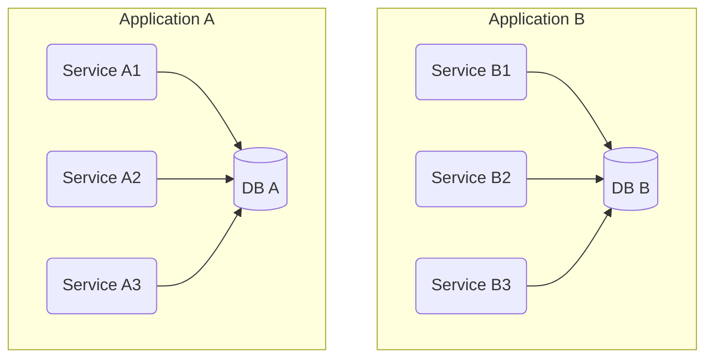
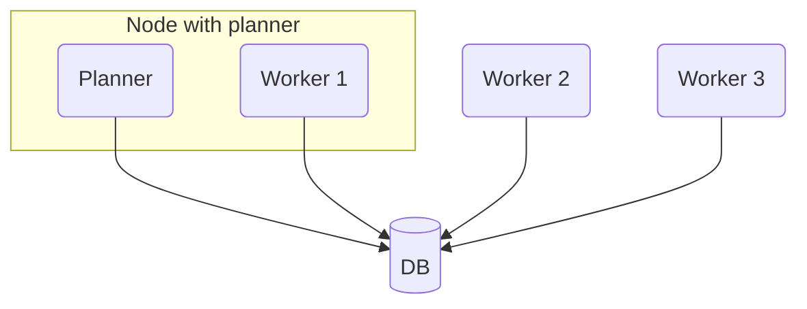
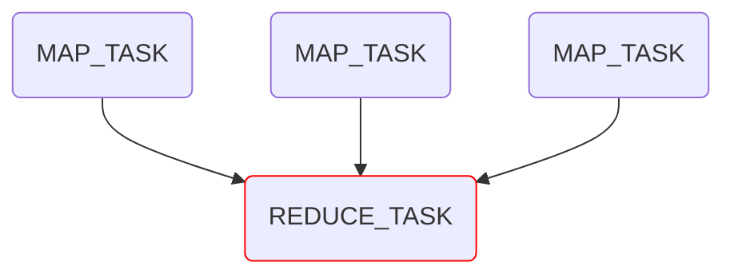
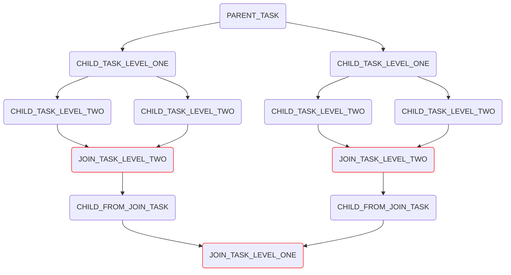

# Distributed Task Framework (DTF)

A lightweight task processor based on a database only. Supports horizontal scaling, affinity protection,
map-reduce (join tasks), stateful tasks, cron tasks and exactly-once execution for DB-bound work.

This document covers the **core** of the project: `distributed-task-library`,
`distributed-task-spring-boot-autoconfigure` and `distributed-task-spring-boot-starter`.
The saga layer built on top of it is described in [../saga/README.md](../saga/README.md),
the test helpers in [../test-utils/dtf/README.md](../test-utils/dtf/README.md).

<!-- TOC -->
* [Distributed Task Framework (DTF)](#distributed-task-framework-dtf)
  * [Introduction](#introduction)
    * [Architecture](#architecture)
    * [Goals](#goals)
    * [Features](#features)
    * [Requirements](#requirements)
  * [Install](#install)
    * [Dependencies](#dependencies)
    * [Database migrations](#database-migrations)
    * [Minimal configuration](#minimal-configuration)
    * [Data source and transactions](#data-source-and-transactions)
      * [Dedicating a separate data source to DTF](#dedicating-a-separate-data-source-to-dtf)
    * [Disabling DTF](#disabling-dtf)
  * [Quick start](#quick-start)
    * [A task that prints a message](#a-task-that-prints-a-message)
    * [What happened](#what-happened)
  * [Concepts](#concepts)
    * [Task and TaskDef](#task-and-taskdef)
    * [ExecutionContext and workflow](#executioncontext-and-workflow)
    * [Scheduling API](#scheduling-api)
      * [Commands issued from inside a task](#commands-issued-from-inside-a-task)
      * [Rescheduling and cancelling](#rescheduling-and-cancelling)
      * [Waiting for completion](#waiting-for-completion)
    * [Failure handling and retry policy](#failure-handling-and-retry-policy)
      * [Fixed retry policy](#fixed-retry-policy)
      * [Backoff retry policy](#backoff-retry-policy)
      * [Disabled retry](#disabled-retry)
    * [Dead letter table](#dead-letter-table)
    * [Cron scheduled tasks](#cron-scheduled-tasks)
    * [Execution guarantees](#execution-guarantees)
      * [At-least-once](#at-least-once)
      * [Exactly-once](#exactly-once)
    * [Concurrency limits](#concurrency-limits)
    * [Timeout](#timeout)
    * [Affinity](#affinity)
    * [Join tasks and map/reduce](#join-tasks-and-mapreduce)
    * [Stateful tasks](#stateful-tasks)
    * [Remote tasks (experimental)](#remote-tasks-experimental)
  * [Configuration](#configuration)
    * [Where settings come from](#where-settings-come-from)
    * [Property reference](#property-reference)
    * [Full example](#full-example)
  * [How it works](#how-it-works)
    * [Lifecycle](#lifecycle)
    * [Cluster membership](#cluster-membership)
    * [Planner and virtual queues](#planner-and-virtual-queues)
    * [Worker](#worker)
    * [Capabilities and rolling upgrades](#capabilities-and-rolling-upgrades)
    * [Database tables](#database-tables)
  * [Metrics](#metrics)
  * [Operations and troubleshooting](#operations-and-troubleshooting)
  * [Migration from 1.x](#migration-from-1x)
  * [Examples](#examples)
  * [Perf tests](#perf-tests)
  * [License](#license)
  * [Disclaimer](#disclaimer)
<!-- TOC -->

## Introduction

### Architecture

DTF turns a set of instances of **one** JVM application that share **one** PostgreSQL database into a task
execution cluster. Nothing else is required: no broker, no coordinator, no extra service.



"Service A1" is one instance of application A. Applications A and B are independent clusters: to start a task in B
from A you call B over REST, a message queue, etc. (there is an experimental [remote task](#remote-tasks-experimental)
mechanism for exactly this).

Inside one cluster every instance is a **worker**, and one instance at a time is additionally the **planner**.
Scaling the application out simply adds workers.



- **Planner** picks tasks that are ready to run and assigns them to workers according to free capacity, CPU load
  and per-task limits. It is elected through the database and fails over automatically.
- **Worker** executes the tasks assigned to its node, applies retry policy, timeouts and cancellation.

Both roles communicate only through DTF tables in your database. That is what makes it possible to schedule a
task **in the same transaction** as your business data and to offer exactly-once execution for DB-bound work.

### Goals

- Build a task execution cluster out of plain JVM microservices. All you need is the DTF starter and a PostgreSQL
  database you already have.
- Keep infrastructure dependencies to a minimum. DTF stores all state in the database and all node-to-node
  communication goes through the database as well.
- Make scheduling transactional with your own data: a task is created atomically with the row that caused it.
- Provide a simple, strongly typed API: a task is a class, a message is a POJO/record, scheduling is one call.

Today DTF schedules tasks inside one application (one deployable, many instances). Cross-application scheduling
exists as an experimental, outbox-based feature (see [Remote tasks](#remote-tasks-experimental)).

### Features

- At-least-once (default) and exactly-once execution guarantees.
- Retry policies: fixed, exponential backoff or none; per task or global; by properties or annotations.
- Dead letter table for tasks that exhausted their retries, with an API to inspect and reschedule them.
- Cron tasks (Spring cron syntax or a plain ISO-8601 period such as `PT30S`), singleton per task name.
- Affinity: tasks working on the same resource run strictly sequentially, everything else runs in parallel.
- Workflows: tasks spawned from a task inherit its workflow and can be cancelled or awaited as a unit.
- Join tasks (map/reduce): a task that starts once all tasks of a branch have completed and receives their results.
- Stateful tasks: keep custom state between retry attempts of the same task instance.
- Delayed scheduling, rescheduling (single task or all tasks of a type, e.g. on HTTP 429), cancellation.
- Blocking `waitCompletion` helpers for tests and synchronous flows.
- Limits: per-node and per-cluster parallelism, per-task timeouts, CPU-based node exclusion from planning.
- Rolling-upgrade safe planner (nodes negotiate capabilities before a new planner generation activates).
- Micrometer metrics for planner, workers and queues.
- Pluggable `TaskSerializer` (Jackson by default) and pluggable JDBC infrastructure (`DtfJdbcInfrastructure`).
- Spring Boot autoconfiguration; a no-op proxy of `DistributedTaskService` when DTF is disabled.

### Requirements

| Requirement | Value |
|---|---|
| Java | 17+ |
| Spring Boot | 3.3.x (the library is built against 3.3.5) |
| Database | PostgreSQL (the SQL and the `_____dtf_virtual_queue_type` enum are PostgreSQL specific) |
| Data access | Spring Data JDBC (brought by the starter) |
| Migrations | Liquibase is recommended; raw SQL is provided for any other tool |

## Install

### Dependencies

Gradle:

```groovy
implementation 'io.github.cherkovskiyandrey:distributed-task-spring-boot-starter:2.0.0-rc.2'

// not transitive, bring your own:
runtimeOnly 'org.postgresql:postgresql'
implementation 'org.liquibase:liquibase-core'
```

Maven:

```xml
<dependency>
    <groupId>io.github.cherkovskiyandrey</groupId>
    <artifactId>distributed-task-spring-boot-starter</artifactId>
    <version>2.0.0-rc.2</version>
</dependency>
```

The starter pulls `distributed-task-spring-boot-autoconfigure`, `distributed-task-library`, `spring-boot-starter`
and `spring-boot-starter-data-jdbc`. The PostgreSQL driver and Liquibase are **not** transitive dependencies.

All released versions are listed on
[Maven Central](https://central.sonatype.com/search?q=g:io.github.cherkovskiyandrey).

### Database migrations

DTF ships its schema as Liquibase changelogs under `db/changelog/distributed-task-framework/` inside
`distributed-task-library`. The simplest way is to include the aggregator, which pulls every DTF changeset in order:

```yaml
databaseChangeLog:
  - include:
      file: db/changelog/distributed-task-framework/db.changelog-aggregator.yaml
```

If you prefer to pin changesets explicitly (for instance to review each upgrade), include them one by one. The
current list is:

```yaml
databaseChangeLog:
  - include:
      file: db/changelog/distributed-task-framework/db.changelog-dtf-init.yaml
  - include:
      file: db/changelog/distributed-task-framework/db.changelog-dtf-002-fix_vq_cdu_index.yaml
  - include:
      file: db/changelog/distributed-task-framework/db.changelog-dtf-003-feature-wait-task.yaml
  - include:
      file: db/changelog/distributed-task-framework/db.changelog-dtf-004-feature-statefull-task.yaml
  - include:
      file: db/changelog/distributed-task-framework/db.changelog-dtf-005-fix-process-deleted-queue-hung.yaml
```

| # | Changelog | Purpose |
|---|---|---|
| 001 | `db.changelog-dtf-init.yaml` | all tables, the `_____dtf_virtual_queue_type` enum, initial indexes |
| 002 | `db.changelog-dtf-002-fix_vq_cdu_index.yaml` | index fix for the virtual queue scan |
| 003 | `db.changelog-dtf-003-feature-wait-task.yaml` | index on `workflow_id`, required by `waitCompletion*` |
| 004 | `db.changelog-dtf-004-feature-statefull-task.yaml` | `local_state` column, required by [stateful tasks](#stateful-tasks) |
| 005 | `db.changelog-dtf-005-fix-process-deleted-queue-hung.yaml` | partial indexes for `NEW`/`PARKED`/`DELETED` queues, fixes planner degradation on big tables (**required for 2.x**) |

If you use another migration tool, apply the raw scripts from
`db/changelog/distributed-task-framework/sql/` (`001_dtf_init.up.sql` … `005_dtf_fix_process_deleted_queue_hung.up.sql`,
each with a matching `.down.sql`). On large production tables apply the index changes of 005 with `CONCURRENTLY`.

**Migration check on startup.** When Liquibase is on the classpath and a `SpringLiquibase` bean exists, DTF
compares the DTF changelog files packed in the library jar with the `filename` column of your `databasechangelog`
table. If a known DTF changelog has not been applied, the application fails to start with
`IllegalStateException: Followed migrations are not deployed [...]`. If the table cannot be read at all the check
logs a warning and is skipped (fail-open). Disable the check with:

```yaml
distributed-task:
  liquibase:
    check-migrations: false
```

### Minimal configuration

```yaml
distributed-task:
  enabled: true
  common:
    app-name: 'hello-app'
```

`distributed-task.enabled` is `false` by default: nothing is started until you switch it on.
`common.app-name` is mandatory; it identifies the cluster and becomes the `appName` part of every `TaskId`.

### Data source and transactions

By default DTF needs no configuration here: it picks up the `PlatformTransactionManager`,
`NamedParameterJdbcOperations` and Spring Data JDBC infrastructure (`Dialect`, `DataAccessStrategy`,
`JdbcMappingContext`, `JdbcConverter`) of your application. With a single data source everything just works, and
your own `@Transactional` methods share one transaction with DTF:

```java
@Transactional
public Order createOrder(OrderDto dto) throws Exception {
    Order order = orderRepository.save(Order.from(dto)); // your data
    distributedTaskService.schedule(                      // DTF task in the SAME transaction
        SEND_NOTIFICATION_TASK,
        ExecutionContext.simple(order.getId())
    );
    return order;                                         // either both are committed, or neither
}
```

This is the main reason DTF stores its state in your database rather than in a broker: a task is scheduled
atomically with the business data that caused it, so there is no "row saved but task lost" window.

#### Dedicating a separate data source to DTF

If your application has several data sources, or you want to keep DTF tables in a separate database, publish your
own `DtfJdbcInfrastructure` bean. DTF uses exactly what you give it for its repositories, transaction templates and
Spring Data JDBC mapping:

```java
@Configuration
public class DtfInfrastructureConfiguration {

    @Bean
    public DtfJdbcInfrastructure dtfJdbcInfrastructure(
        @Qualifier("secondaryTransactionManager") PlatformTransactionManager transactionManager,
        @Qualifier("secondaryNamedParameterJdbcOperations") NamedParameterJdbcOperations jdbcOperations,
        @Qualifier("secondaryJdbcDialect") Dialect dialect,
        @Qualifier("secondaryDataAccessStrategy") DataAccessStrategy dataAccessStrategy,
        @Qualifier("secondaryJdbcMappingContext") JdbcMappingContext jdbcMappingContext,
        @Qualifier("secondaryJdbcConverter") JdbcConverter jdbcConverter
    ) {
        return new DtfJdbcInfrastructure(
            transactionManager,
            jdbcOperations,
            dialect,
            dataAccessStrategy,
            jdbcMappingContext,
            jdbcConverter
        );
    }
}
```

The autoconfiguration declares its own bean as `@ConditionalOnMissingBean(DtfJdbcInfrastructure.class)`, so yours
wins. A complete example of building a secondary Spring Data JDBC stack by extending `AbstractJdbcConfiguration`
lives in the autoconfigure module tests (`SecondaryDataSourceConfiguration`, `DtfDataSourceAsSecondaryConfiguration`).

Keep in mind when DTF gets its own data source:

- **Your `@Transactional` methods no longer share a transaction with DTF.** Saving business data and scheduling a
  task become two independent transactions, so the atomicity shown above is lost.
- **The transaction manager you pass must be a bean of the application context.** DTF resolves its bean name to
  wire Spring Data repositories and fails fast with
  `BeanInitializationException: Can't detect bean name of PlatformTransactionManager [...]` otherwise.
- **The migration check still uses the default `SpringLiquibase` data source.** Run the DTF changelogs against the
  DTF database yourself and, if the default Liquibase does not see them, disable the check.

### Disabling DTF

With `distributed-task.enabled=false` (or the property absent) no DTF beans, threads or DB access are created.
A JDK proxy is still registered as `DistributedTaskService`, so code that autowires it keeps compiling and running.
Every call logs a warning and returns a neutral value (`false`, `0`, empty collections, `Optional.empty()`, a dummy
`TaskId`). This is handy for local profiles and for modules that are deployed with and without DTF.

## Quick start

### A task that prints a message

Set up the dependency and the migrations as described in [Install](#install).

Define a message. Any Jackson-serializable class works; records are the shortest option.

```java
public record HelloMessage(String helloText) {
}
```

Implement `com.distributed_task_framework.task.Task` and register it as a Spring bean. The `TaskDef` is the
identity of the task: its name must be unique inside the application.

```java
import com.distributed_task_framework.model.ExecutionContext;
import com.distributed_task_framework.model.TaskDef;
import com.distributed_task_framework.task.Task;
import org.springframework.stereotype.Component;

@Component
public class HelloTask implements Task<HelloMessage> {
    public static final TaskDef<HelloMessage> HELLO_TASK_DEF =
        TaskDef.privateTaskDef("HELLO_TASK", HelloMessage.class);

    @Override
    public TaskDef<HelloMessage> getDef() {
        return HELLO_TASK_DEF;
    }

    @Override
    public void execute(ExecutionContext<HelloMessage> executionContext) {
        System.out.println(executionContext.getInputMessageOrThrow().helloText());
    }
}
```

Schedule it from anywhere you can inject `DistributedTaskService`:

```java
import com.distributed_task_framework.model.ExecutionContext;
import com.distributed_task_framework.model.TaskId;
import com.distributed_task_framework.service.DistributedTaskService;
import org.springframework.web.bind.annotation.*;

@RestController
@RequestMapping("/simple")
public class SimpleController {
    private final DistributedTaskService distributedTaskService;

    public SimpleController(DistributedTaskService distributedTaskService) {
        this.distributedTaskService = distributedTaskService;
    }

    @PostMapping("/say-hello")
    public TaskId sayHello(@RequestBody String helloText) throws Exception {
        return distributedTaskService.schedule(
            HelloTask.HELLO_TASK_DEF,
            ExecutionContext.simple(new HelloMessage(helloText))
        );
    }
}
```

Start the application and `POST` some text to `http://localhost:8080/simple/say-hello`. The text appears in the
console of one of the instances.

### What happened

1. `distributed-task.enabled=true` activated the autoconfiguration. During context startup every `Task` bean was
   discovered and registered in the in-memory task registry with its effective `TaskSettings`
   (code defaults, overridden by properties and annotations).
2. After the context was refreshed DTF started its background threads: the cluster heartbeat, the registry
   publisher (which writes the node's task names into `_____dtf_registered_tasks`), the planner watchdogs, the
   worker manager and the completion handler.
3. `schedule()` serialized `HelloMessage` with Jackson and inserted a row into `_____dtf_tasks` in the virtual
   queue `NEW`. Because the call was not inside a transaction, the row was committed immediately.
4. The node that holds the planner lease moved the task `NEW → READY`, then assigned it to a node that has
   `HELLO_TASK` registered and free capacity. The planner polls with an adaptive delay: 1 s when the last poll found
   nothing, 500 ms for up to 100 tasks, no delay above that (`distributed-task.common.planner.polling-delay`).
5. The worker manager of the assigned node picked the row up (`distributed-task.common.worker-manager.manage-delay`),
   ran `execute()` on a worker thread and, on success, moved the task to the `DELETED` queue, from where the planner
   purges it. On failure the task would have been retried according to its retry policy (fixed delay of 10 s,
   up to 6 attempts by default) and finally stored in the dead letter table.

## Concepts

### Task and TaskDef

A task is an implementation of the `Task<T>` interface, where `T` is the type of its input message:

```java
public interface Task<T> {

    TaskDef<T> getDef();

    default void execute(ExecutionContext<T> executionContext) throws Exception {
    }

    default void onFailure(FailedExecutionContext<T> failedExecutionContext) throws Exception {
    }

    /**
     * @return true to stop retrying (the error is unrecoverable), false to follow the retry policy
     */
    default boolean onFailureWithResult(FailedExecutionContext<T> failedExecutionContext) throws Exception {
        onFailure(failedExecutionContext);
        return false;
    }
}
```

- `getDef()` returns the task definition DTF uses to register, route and schedule the task.
- `execute()` is the business logic. Throwing any exception marks the attempt as failed.
- `onFailureWithResult()` (or the simpler `onFailure()`) is called after a failed attempt. It receives a
  `FailedExecutionContext` with the error, the number of failures so far and `isLastAttempt()`. Return `true` to
  interrupt retries immediately (the task goes to the dead letter table if enabled).

`TaskDef` has two flavours:

```java
// local task of this application; appName is filled from distributed-task.common.app-name on registration
TaskDef<HelloMessage> def1 = TaskDef.privateTaskDef("HELLO_TASK", HelloMessage.class);
TaskDef<Void> def2 = TaskDef.privateTaskDef("NO_INPUT_TASK");
// generic message types need a TypeReference, otherwise Jackson loses the type parameters
TaskDef<List<UUID>> def3 = TaskDef.privateTaskDef("BATCH_TASK", new TypeReference<List<UUID>>() {});

// task of another application (see Remote tasks)
TaskDef<OrderDto> def4 = TaskDef.publicTaskDef("billing-app", "CHARGE_TASK", OrderDto.class);
```

Equality of `TaskDef` is by `appName` + `taskName` only, so two tasks with the same name in one application are a
configuration error.

Tasks are normally Spring beans discovered on startup. You can also register them programmatically through
`DistributedTaskService.registerTask(task[, taskSettings])`, check `isTaskRegistered(taskDef)` and
`unregisterTask(taskDef)` at runtime.

**Messages** are serialized with the `TaskSerializer` bean. The default one is Jackson with `JavaTimeModule`,
`Jdk8Module`, `KotlinModule`, `NON_NULL` inclusion and lenient reading (unknown properties and unknown enum values
are ignored), which makes rolling deployments with message schema changes safe in practice. Provide your own
`TaskSerializer` bean to replace it.

### ExecutionContext and workflow

`ExecutionContext<T>` is what a task receives and what you pass when scheduling. Besides the input message it
carries the **workflow** identity and the affinity:

| Field | Meaning |
|---|---|
| `workflowId` | groups related tasks; generated by the static factories, inherited by `withNewMessage`/`withEmptyMessage` |
| `workflowCreatedDateUtc` | creation time of the workflow, used to order workflows with the same affinity |
| `currentTaskId` | id of the task being executed (set by DTF) |
| `affinityGroup`, `affinity` | see [Affinity](#affinity) |
| `inputMessage` | the message, `getInputMessageOpt()` / `getInputMessageOrThrow()` |
| `inputJoinTaskMessages` | messages collected for a [join task](#join-tasks-and-mapreduce) |
| `executionAttempt` | 1 for the first attempt, incremented on every retry |

Create a context with one of the factories:

```java
ExecutionContext.simple(message);                                  // new workflow, no affinity
ExecutionContext.empty();                                          // new workflow, no message
ExecutionContext.withAffinityGroup(message, "ORDERS", orderId);    // new workflow with affinity
```

Inside a task derive a context for child tasks from the current one so that they stay in the same workflow and
keep the affinity:

```java
@Override
public void execute(ExecutionContext<ParentMessage> ctx) throws Exception {
    distributedTaskService.schedule(CHILD_TASK, ctx.withNewMessage(new ChildMessage(...)));
    distributedTaskService.schedule(CLEANUP_TASK, ctx.withEmptyMessage());
}
```

A workflow is the unit for cancellation (`cancelWorkflowByTaskId`) and waiting (`waitCompletionAllWorkflow`), and
join tasks are resolved inside a workflow. If you create a fresh context inside a task (`ExecutionContext.simple`)
you intentionally start an unrelated workflow.

### Scheduling API

`DistributedTaskService` is the single entry point. The scheduling family:

```java
TaskId schedule(TaskDef<T> taskDef, ExecutionContext<T> ctx);
TaskId schedule(TaskDef<T> taskDef, ExecutionContext<T> ctx, Duration delay);
TaskId scheduleImmediately(TaskDef<T> taskDef, ExecutionContext<T> ctx[, Duration delay]);
TaskId scheduleFork(TaskDef<T> taskDef, ExecutionContext<T> ctx[, Duration delay]);
TaskId scheduleJoin(TaskDef<T> taskDef, ExecutionContext<T> ctx, List<TaskId> joinList);
TaskId scheduleUnsafe(TaskDef<T> taskDef, ExecutionContext<T> ctx);
```

- `schedule` inserts the task; with `delay` it becomes eligible for planning only after the delay (not allowed for
  cron tasks).
- `scheduleFork` is `schedule` that excludes the child from the join hierarchy of the current task (see
  [Join tasks](#join-tasks-and-mapreduce)).
- `scheduleUnsafe` schedules a task that is not registered on this node but is registered on at least one other
  node of the cluster. DTF cannot validate the message type or cron-ness in that case, hence the name. Throws
  `UnknownTaskException` if no node knows the task.
- `TaskId` contains `appName`, `taskName`, `id` and `workflowId`; keep it if you want to cancel, reschedule or
  await the task later.

#### Commands issued from inside a task

When `schedule`, `reschedule` or `cancel*` are called **from a running task**, DTF does not apply them right away.
They are buffered and executed in the same transaction that finalizes the current task attempt. This gives you a
simple mental model: either the task completes and all its commands take effect, or the task fails and nothing it
tried to schedule leaks out, so a retry starts from a clean slate.

Every command has an `…Immediately` twin (`scheduleImmediately`, `rescheduleImmediately`,
`cancelTaskExecutionImmediately`, …) that bypasses the buffer and is applied at once. Use them when a child task
must exist before the parent finishes, for example to start work in parallel with a long parent.

Outside a task both variants behave the same.

#### Rescheduling and cancelling

```java
void reschedule(TaskId taskId, Duration delay);
void rescheduleByTaskDef(TaskDef<T> taskDef, Duration delay);   // all not-running tasks of this type

boolean cancelTaskExecution(TaskId taskId);                     // only if not started yet
boolean cancelAllTaskByTaskDef(TaskDef<T> taskDef);
boolean cancelWorkflowByTaskId(TaskId taskId);                  // every task of the workflow
boolean cancelAllWorkflowsByTaskId(List<TaskId> taskIds);
```

`rescheduleByTaskDef` is the tool for back-pressure: when an external service answers `429`, postpone every pending
task of that type in one call. Cancelling a task that is already running interrupts its thread; the task should
react to `InterruptedException` and finish quickly.

#### Waiting for completion

```java
void waitCompletion(TaskId taskId[, Duration timeout]);
void waitCompletionAllWorkflow(TaskId taskId[, Duration timeout]);
void waitCompletionAllWorkflows(Collection<TaskId> taskIds[, Duration timeout]);
```

These block until the task (or every task of the workflow) has disappeared from `_____dtf_tasks`, which includes
successful completion, cancellation and moving to the dead letter table. Default timeouts are
`distributed-task.common.completion.default-task-timeout` / `default-workflow-timeout` (1 minute);
`TimeoutException` is thrown on expiry. Completion is detected by a poller
(`completion.handler-fixed-delay`, 1 s), so expect up to one second of latency.

Calling `waitCompletion*` **from inside a task** is prohibited and throws `InvalidOperationException`: a worker
thread blocked on another task is the fastest way to deadlock a cluster.

### Failure handling and retry policy

An attempt fails when `execute()` throws. DTF then:

1. Increments the failure counter and computes the next retry from the task's retry policy.
2. Calls `onFailureWithResult(FailedExecutionContext)`. Returning `true` stops retrying.
3. If there is a next attempt, reschedules the task (another node may pick it up). Otherwise the task is finalized:
   stored in the [dead letter table](#dead-letter-table) when `dltEnabled`, or simply removed.

Retry policies:

| Mode | Behaviour | Defaults |
|---|---|---|
| `FIXED` (**default**) | constant delay, limited number of attempts and/or total interval | `delay=PT10S`, `max-number=6`, `max-interval` unset |
| `BACKOFF` | `initial-delay` for the first retry, then `delay-period * 2^(failures-1)`, each delay capped by `max-delay` | `initial-delay=PT10S`, `delay-period=PT10S`, `max-retries=32`, `max-delay=PT1H` |
| `OFF` | no retries | |

A policy is chosen globally in `task-properties-group.default-properties.retry`, per task in
`task-properties-group.task-properties.<TASK_NAME>.retry`, or with one of the annotations `@TaskFixedRetryPolicy`,
`@TaskBackoffRetryPolicy`, `@RetryOff` on the task class (only one of them per class). See
[Where settings come from](#where-settings-come-from) for precedence.

#### Fixed retry policy

As the default for all tasks:

```yaml
distributed-task:
  task-properties-group:
    default-properties:
      retry:
        retry-mode: FIXED
        fixed:
          # delay between attempts
          delay: PT10S
          # max number of attempts
          max-number: 10
          # give up when attempts span longer than this (optional)
          max-interval: P1D
```

For one task (overrides defaults and annotations):

```yaml
distributed-task:
  task-properties-group:
    task-properties:
      MY_TASK_DEF:
        retry:
          retry-mode: FIXED
          fixed:
            delay: PT10S
            max-number: 10
            max-interval: P1D
```

With an annotation:

```java
@Component
@TaskFixedRetryPolicy(delay = "PT10S", number = 10, maxInterval = "P10D")
public class MyTask implements Task<MyMessage> {
    public static final TaskDef<MyMessage> MY_TASK_DEF = TaskDef.privateTaskDef("MY_TASK_DEF", MyMessage.class);
    // ...
}
```

#### Backoff retry policy

Exponential backoff ([background](https://en.wikipedia.org/wiki/Exponential_backoff)): the first retry happens
after `initial-delay`, the n-th retry after `delay-period * 2^(n-1)`, and no single delay exceeds `max-delay`.

As the default for all tasks:

```yaml
distributed-task:
  task-properties-group:
    default-properties:
      retry:
        retry-mode: BACKOFF
        backoff:
          # delay before the first retry
          initial-delay: PT10S
          # base of the geometric progression: delayPeriod * 2^(failures-1)
          delay-period: PT5S
          # max number of retries
          max-retries: 1000
          # cap for a single delay
          max-delay: PT1H
```

For one task:

```yaml
distributed-task:
  task-properties-group:
    task-properties:
      MY_TASK_DEF:
        retry:
          retry-mode: BACKOFF
          backoff:
            initial-delay: PT10S
            delay-period: PT5S
            max-retries: 1000
            max-delay: PT1H
```

With an annotation:

```java
@Component
@TaskBackoffRetryPolicy(initialDelay = "PT10S", delayPeriod = "PT5S", maxRetries = 1000, maxDelay = "PT1H")
public class MyTask implements Task<MyMessage> {
    // ...
}
```

#### Disabled retry

```yaml
distributed-task:
  task-properties-group:
    default-properties:
      retry:
        retry-mode: OFF
```

```yaml
distributed-task:
  task-properties-group:
    task-properties:
      MY_TASK_DEF:
        retry:
          retry-mode: OFF
```

```java
@Component
@RetryOff
public class MyTask implements Task<MyMessage> {
    // ...
}
```

### Dead letter table

When a task has exhausted its retries (or `onFailureWithResult` returned `true`) it is moved to `_____dtf_dlt_tasks`
together with its execution context and the last error. This is enabled by default and can be switched per task:

```yaml
distributed-task:
  task-properties-group:
    default-properties:
      dlt-enabled: true
    task-properties:
      MY_TASK_DEF:
        dlt-enabled: false
```

```java
@Component
@TaskDltEnable(isEnabled = false)
public class MyTask implements Task<MyMessage> {
    // ...
}
```

Cron tasks never go to the dead letter table: after a failed series they simply wait for the next cron tick.

`DistributedTaskService` exposes the table so you can build an admin endpoint on top of it:

```java
Collection<TaskDef<?>> getDltTaskDefs();                                   // which task types have dead letters
<T> Page<DltTask<?>> getDltTasksByDef(TaskDef<T> taskDef, Pageable page);  // taskId, executionContext, errorMessage, errorCode
void rescheduleDltTasks(Collection<DltTask<?>> dltTasks);                  // put them back into the queue
```

### Cron scheduled tasks

A task becomes recurrent when it has a `cron` setting. Two formats are accepted:

- Spring cron with six fields (`0 */5 * * * *`), validated with Spring's `CronExpression`;
- an ISO-8601 duration such as `PT30S` or `PT1H`, meaning "run every 30 seconds / every hour".

```yaml
distributed-task:
  task-properties-group:
    task-properties:
      MY_TASK_DEF:
        cron: '0 * * * * *'
      MY_OTHER_TASK_DEF:
        cron: 'PT30S'
```

```java
@Component
@TaskSchedule(cron = "0 * * * * *")
public class MyTask implements Task<Void> {
    public static final TaskDef<Void> MY_TASK_DEF = TaskDef.privateTaskDef("MY_TASK_DEF");
    // ...
}
```

Cron tasks are **singletons per task name**: DTF schedules one instance on startup (enforced by a unique index on
`_____dtf_tasks`), and `schedule()` for a cron task returns the id of the existing instance instead of creating a
second one. After every run the task is rescheduled to the next cron date. Delayed scheduling is rejected for cron
tasks. In tests cron tasks are usually disabled, see [test-utils](../test-utils/dtf/README.md).

### Execution guarantees

#### At-least-once

The default. The task body runs outside any DTF transaction; its completion is recorded afterwards in a separate
transaction. If the node dies between the two, the task will run again. Design such tasks to be idempotent or
guard them with the [exactly-once](#exactly-once) mode.

```yaml
distributed-task:
  task-properties-group:
    default-properties:
      execution-guarantees: AT_LEAST_ONCE
    task-properties:
      MY_TASK_DEF:
        execution-guarantees: AT_LEAST_ONCE
```

```java
@Component
@TaskExecutionGuarantees(TaskSettings.ExecutionGuarantees.AT_LEAST_ONCE)
public class MyTask implements Task<MyMessage> {
    // ...
}
```

#### Exactly-once

The task body and the finalization of the task run in **one** database transaction on the DTF transaction
manager. If `execute()` throws, every DB change made through that transaction manager is rolled back together with
the task state, and the next attempt starts as if nothing happened. If the node dies, the uncommitted transaction
disappears and the task is re-planned.

This covers database work only. A REST call or a Kafka message sent inside the task can still be repeated. For
mixed work keep the DB part exactly-once and make the external part idempotent, or split it into a separate
at-least-once task.

```yaml
distributed-task:
  task-properties-group:
    default-properties:
      execution-guarantees: EXACTLY_ONCE
    task-properties:
      MY_TASK_DEF:
        execution-guarantees: EXACTLY_ONCE
```

```java
@Component
@TaskExecutionGuarantees(TaskSettings.ExecutionGuarantees.EXACTLY_ONCE)
public class MyTask implements Task<MyMessage> {
    // ...
}
```

Exactly-once requires that your repositories use the same transaction manager as DTF, which is the case with a
single data source (see [Data source and transactions](#data-source-and-transactions)).

### Concurrency limits

Three independent knobs control how many tasks run at the same time.

**Per node, all tasks.** The size of the worker thread pool of every instance (default 100):

```yaml
distributed-task:
  common:
    worker-manager:
      max-parallel-tasks-in-node: 100
```

**Per cluster, per task type.** How many instances of a task may run in the whole cluster. `-1` means unlimited and
is the default. The planner default applies to task types without their own value:

```yaml
distributed-task:
  common:
    planner:
      max-parallel-tasks-in-cluster-default: -1
  task-properties-group:
    default-properties:
      max-parallel-in-cluster: 100
    task-properties:
      MY_TASK_DEF:
        max-parallel-in-cluster: 10
        max-parallel-in-node: 2
```

**Per node, per task type.** `max-parallel-in-node` limits how many instances of one task type a single node may
run, useful for tasks that hold a scarce local resource.

```java
@Component
@TaskConcurrency(maxParallelInCluster = 10, maxParallelInNode = 2)
public class MyTask implements Task<MyMessage> {
    // ...
}
```

For unlimited task types the planner over-plans by `distributed-task.common.planner.plan-factor` (2.0) to hide the
latency between planning loops. Nodes whose median CPU load exceeds
`distributed-task.common.planner.node-cpu-loading-limit` (0.95) are skipped by the planner entirely.

### Timeout

A task that runs longer than its timeout is interrupted: its worker thread gets `Thread.interrupt()`, so blocking
calls throw `InterruptedException` and the attempt counts as failed. `PT0S` (the default) disables the timeout.

```yaml
distributed-task:
  task-properties-group:
    default-properties:
      timeout: PT1H
    task-properties:
      MY_TASK_DEF:
        timeout: PT10M
```

```java
@Component
@TaskTimeout("PT1H")
public class MyTask implements Task<MyMessage> {
    // ...
}
```

Timeouts are enforced by the worker manager loop, so the precision is the `manage-delay` of that loop (up to 1 s).

### Affinity

By default all tasks run concurrently. Often tasks that touch the same resource (an order, an account, a user) must
not overlap. Affinity solves this without locks in your code.

An affinity is always scoped by an **affinity group**: the group is usually a constant (`"ORDERS"`), the affinity
is the resource id. The guarantee is:

> Workflows with the same `affinityGroup` + `affinity` are executed one after another, in the order of their
> `workflowCreatedDateUtc`. While an earlier workflow still has tasks, the tasks of later workflows wait in the
> `PARKED` queue.

Tasks **inside one workflow** with the same affinity are not serialized against each other; that is what makes
parallel children with a shared affinity possible.

```java
public void runSequentially(String orderId) throws Exception {
    distributedTaskService.schedule(
        RESERVE_TASK,
        ExecutionContext.withAffinityGroup(new OrderMessage(orderId), "ORDERS", orderId)
    );
    distributedTaskService.schedule(
        CHARGE_TASK,
        ExecutionContext.withAffinityGroup(new OrderMessage(orderId), "ORDERS", orderId)
    );
}
```



```mermaid
gantt
    title Same group and affinity, different workflows
    dateFormat s
    axisFormat t
    RESERVE_TASK: active, a, 0, 1
    CHARGE_TASK: active, b, 1, 2
```

Different affinity groups do not interact even with the same affinity value:

```java
public void runInParallel(String id) throws Exception {
    distributedTaskService.schedule(
        TASK_1,
        ExecutionContext.withAffinityGroup(new Message(id), "GROUP_1", id)
    );
    distributedTaskService.schedule(
        TASK_2,
        ExecutionContext.withAffinityGroup(new Message(id), "GROUP_2", id)
    );
}
```



```mermaid
gantt
    title Different groups, same affinity
    dateFormat s
    axisFormat t
    TASK_1: active, a, 0, 1
    TASK_2: active, b, 0, 1
```

Tasks created with `ExecutionContext.simple()` have no affinity and never wait for anything.

Notes:

- Affinity is inherited by `withNewMessage()` / `withEmptyMessage()`, so child tasks stay serialized with the
  parent workflow automatically.
- Serialization is enforced by the planner through virtual queues (see
  [Planner and virtual queues](#planner-and-virtual-queues)), not by database locks, so it costs nothing on the
  worker side.
- It is a good habit to set an affinity whenever tasks of a workflow mutate shared data.

### Join tasks and map/reduce

A join task runs only after **all tasks of a branch** have completed, no matter whether they succeeded or failed,
and it receives messages collected from that branch. This is the building block for map/reduce and for fan-out /
fan-in workflows.

```java
@Override
public void execute(ExecutionContext<MapReduceDto> ctx) throws Exception {
    List<TaskId> tasksToJoin = new ArrayList<>();
    for (List<String> partition : partitions(ctx.getInputMessageOrThrow().text())) {
        tasksToJoin.add(distributedTaskService.schedule(MAP_TASK, ctx.withNewMessage(new MapDto(partition))));
    }
    // REDUCE_TASK starts when every MAP_TASK (and anything they spawn) is finished
    distributedTaskService.scheduleJoin(REDUCE_TASK, ctx.withEmptyMessage(), tasksToJoin);
}
```

`scheduleJoin` must be called inside a transaction or from a task (the link between the tasks to join and the
join task is written atomically with the tasks themselves).

Passing results to the join task is explicit. Each task of the branch asks for its outgoing join messages and sets
the payload:

```java
// inside MAP_TASK
Map<String, Integer> wordsFreq = countWords(ctx.getInputMessageOrThrow().words());
JoinTaskMessage<ReduceDto> msg = distributedTaskService.getJoinMessagesFromBranch(REDUCE_TASK).get(0);
distributedTaskService.setJoinMessageToBranch(msg.toBuilder().message(new ReduceDto(wordsFreq)).build());
```

The join task reads them from the context:

```java
// inside REDUCE_TASK
@Override
public void execute(ExecutionContext<ReduceDto> ctx) {
    List<ReduceDto> partials = ctx.getInputJoinTaskMessages();
    // merge and print the top 10 words
}
```



Links are inherited: when a task of the branch schedules its own children, the join task waits for them too, so
arbitrary DAG depth works. Use `scheduleFork` for a child that must **not** delay the join (fire-and-forget
notifications, for instance). Join tasks can be nested; the complete example
[ParentTask](../examples/distributed-task-test-application/src/main/java/com/distributed_task_framework/test_service/tasks/ParentTask.java)
builds this graph:



The full map/reduce sample lives in
[examples/distributed-task-test-application/.../mapreduce](../examples/distributed-task-test-application/src/main/java/com/distributed_task_framework/test_service/tasks/mapreduce).

### Stateful tasks

A `StatefulTask<T, U>` keeps a piece of state `U` **between retry attempts of the same task instance**. Typical
uses: remember how far a multi-step import got before it failed, or keep an external operation id so that a retry
polls instead of starting over.

```java
@Component
public class ImportTask implements StatefulTask<ImportRequest, ImportProgress> {
    public static final TaskDef<ImportRequest> DEF = TaskDef.privateTaskDef("IMPORT_TASK", ImportRequest.class);

    @Override
    public TaskDef<ImportRequest> getDef() {
        return DEF;
    }

    @Override
    public TypeDef<ImportProgress> stateDef() {
        return TypeDef.of(ImportProgress.class);
    }

    @Override
    public void execute(ExecutionContext<ImportRequest> ctx, StateHolder<ImportProgress> state) throws Exception {
        ImportProgress progress = state.get().orElse(ImportProgress.start());
        for (Chunk chunk : remaining(ctx.getInputMessageOrThrow(), progress)) {
            importChunk(chunk);
            progress = progress.advance(chunk);
            state.set(progress); // persisted if this attempt fails and is retried
        }
    }

    @Override
    public boolean onFailureWithResult(FailedExecutionContext<ImportRequest> ctx,
                                       StateHolder<ImportProgress> state) {
        log.warn("attempt {} failed at {}", ctx.getExecutionAttempt(), state.get(), ctx.getError());
        return false;
    }
}
```

The state is serialized with the `TaskSerializer` into the `local_state` column when the task is rescheduled for a
retry and restored before the next attempt. `TypeDef.of(new TypeReference<...>() {})` is available for generic
state types. Requires migration 004.

### Remote tasks (experimental)

A remote task is a task of **another application** addressed by `TaskDef.publicTaskDef(appName, taskName, type)`.
Register it with `registerRemoteTask(taskDef[, settings])` (or a `RemoteTasks` bean) and map the application name
to a URL:

```yaml
distributed-task:
  common:
    delivery-manager:
      remote-apps:
        app-to-url:
          billing-app: http://billing-app
```

Commands for remote tasks (`schedule`, `reschedule`, `cancel`) are written to the outbox table
`_____dtf_remote_commands` and delivered by one elected node per remote application, in batches, over HTTP
(`POST <url>/v1/distributed-task-framework`, multipart part `commands`), with their own retry policy
(`delivery-manager.retry`) and a dead letter table for commands (`_____dtf_dlc_commands`).

**The receiving side is not part of the library yet**: the target application has to expose that endpoint and
feed the commands into its own `DistributedTaskService`. Treat the feature as a building block, not as a finished
product.

## Configuration

### Where settings come from

Every task runs with an effective `TaskSettings`. It is assembled from four layers; a value set in a higher layer
overrides the same value from a lower one, unset values fall through:

1. per-task properties `distributed-task.task-properties-group.task-properties.<TASK_NAME>.*` (highest);
2. annotations on the task class (`@TaskSchedule`, `@TaskConcurrency`, `@TaskExecutionGuarantees`, `@TaskDltEnable`,
   `@TaskFixedRetryPolicy` / `@TaskBackoffRetryPolicy` / `@RetryOff`, `@TaskTimeout`);
3. default properties `distributed-task.task-properties-group.default-properties.*`;
4. code defaults (`TaskSettings.DEFAULT`: at-least-once, DLT on, FIXED retry 10 s × 6, unlimited parallelism,
   no timeout, no cron).

`<TASK_NAME>` is the `taskName` of the `TaskDef`. Cluster-wide settings live under `distributed-task.common.*`.

### Property reference

The generated table of every property with its description is in
[config-prop.md](distributed-task-spring-boot-autoconfigure/config-prop.md). The most relevant groups:

| Group | Purpose |
|---|---|
| `distributed-task.enabled` | master switch, `false` by default |
| `distributed-task.common.app-name` | cluster / application name, required |
| `distributed-task.liquibase.check-migrations` | fail fast when DTF changelogs are missing, `true` by default |
| `distributed-task.common.registry.*` | heartbeat period (4 s), node expiry (20 s), cluster cache (1 s), CPU window (5 m) |
| `distributed-task.common.planner.*` | watchdog period (5 s), batch sizes (1000 / 300 / 300), `polling-delay`, `plan-factor`, `node-cpu-loading-limit`, `max-parallel-tasks-in-cluster-default` |
| `distributed-task.common.worker-manager.*` | `max-parallel-tasks-in-node` (100), `manage-delay` |
| `distributed-task.common.completion.*` | `waitCompletion*` poll period and default timeouts (1 s / 1 m) |
| `distributed-task.common.statistics.*` | period of queue statistics / metrics (10 s) |
| `distributed-task.common.delivery-manager.*` | remote tasks: URLs, batch size, HTTP timeouts, retry |
| `distributed-task.task-properties-group.default-properties.*` | defaults for every task |
| `distributed-task.task-properties-group.task-properties.<TASK_NAME>.*` | overrides for one task |

`polling-delay` and `manage-delay` are step functions "number of items handled in the last loop → sleep in ms".
Keys must be increasing; a key `K` covers the range `(previousKey, K]`. The planner default is

```yaml
distributed-task:
  common:
    planner:
      polling-delay:
        0: 1000     # nothing planned          -> sleep 1 s
        100: 500    # 1..100 tasks planned     -> sleep 500 ms
        1000: 0     # 101..1000 tasks planned  -> no sleep
```

### Full example

```yaml
distributed-task:
  enabled: true
  liquibase:
    check-migrations: true
  common:
    app-name: orders-app
    completion:
      handler-fixed-delay: PT1S
      default-task-timeout: PT1M
      default-workflow-timeout: PT5M
    registry:
      update-fixed-delay-ms: 4000
      max-inactivity-interval-ms: 20000
    planner:
      max-parallel-tasks-in-cluster-default: -1
      batch-size: 1000
      node-cpu-loading-limit: 0.95
      polling-delay:
        0: 1000
        100: 500
        1000: 0
    worker-manager:
      max-parallel-tasks-in-node: 100
      manage-delay:
        0: 1000
        50: 500
        100: 250

  task-properties-group:
    default-properties:
      execution-guarantees: AT_LEAST_ONCE
      dlt-enabled: true
      retry:
        retry-mode: BACKOFF
        backoff:
          initial-delay: PT10S
          delay-period: PT5S
          max-retries: 20
          max-delay: PT1H
      timeout: PT10M
    task-properties:
      SEND_EMAIL_TASK:
        max-parallel-in-cluster: 20
        retry:
          retry-mode: FIXED
          fixed:
            delay: PT30S
            max-number: 5
      NIGHTLY_REPORT_TASK:
        cron: '0 0 3 * * *'
        execution-guarantees: EXACTLY_ONCE
        dlt-enabled: false
```

## How it works

### Lifecycle

Every DTF service implements `DistributedTaskServiceLifecycle` with four phases: `init → start → stop → cleanup`.
A single `DistributedTaskLifecycleSpringInitializer` (a `SmartLifecycle` running in the last phase) drives them:

- `init()` runs as each bean is created: tasks are registered, settings are merged, capabilities are recorded.
- `start()` runs after the whole context is refreshed and **in bean-creation order**: heartbeat, registry publisher,
  planner watchdogs, worker manager, completion handler, statistics and cron scheduling start here. Any exception
  aborts application startup.
- `stop()` runs on context shutdown in **reverse dependency order**: loops are stopped and thread pools are drained
  (up to 1 minute for running tasks).
- `cleanup()` runs during bean destruction, strictly after every service is stopped: the node deletes its own rows
  (`_____dtf_node_state`, `_____dtf_registered_tasks`, planner lease, capabilities).

The practical consequence: no DTF thread touches the database before your application context is complete, and a
graceful shutdown leaves no stale node behind.

### Cluster membership

Each node gets a random `nodeId` at startup and upserts a heartbeat row in `_____dtf_node_state` every
`registry.update-fixed-delay-ms` (4 s) together with its median CPU load and its capabilities. Nodes whose heartbeat
is older than `registry.max-inactivity-interval-ms` (20 s) are deleted by any surviving node; every node-scoped row
(planner lease, registered tasks, capabilities) cascades with it.

Nodes also publish the names of the tasks they have registered (`_____dtf_registered_tasks`), so during a rolling
deployment the planner never assigns a brand-new task type to an old node that does not know it. If that happens
anyway (a task was unregistered at runtime) the worker releases the task back to the queue and counts
`workerManager.unknown`.

### Planner and virtual queues

Planning is split between three cooperating planners. Each has its own lease row in `_____dtf_planner_table`
(unique per group) and a watchdog on every node: whoever inserts the lease first becomes the active planner of that
group, the others back off and re-check every `planner.watchdog-fixed-delay-ms`. When the leader node disappears,
its lease is cascaded away and another node takes over on its next watchdog tick.

| Planner group | Class | Responsibility |
|---|---|---|
| `vqb_manager` | `VirtualQueueManagerPlannerImpl` | moves tasks between virtual queues, purges completed tasks, keeps the partition tracker |
| `default` | `VirtualQueueBaseFairTaskPlannerImpl` | assigns `READY` tasks to nodes, fairly across (affinity group, task name) partitions, respecting all limits |
| `join` | `JoinTaskPlannerImpl` | releases join tasks whose branches have all completed and merges their messages |

Every task row lives in one of four **virtual queues** (`virtual_queue` column):

| Queue | Meaning |
|---|---|
| `NEW` | freshly scheduled tasks (a task created from a parent with the same affinity may skip this stage) |
| `READY` | tasks eligible for assignment; no other workflow with the same affinity is ahead of them |
| `PARKED` | tasks waiting because an earlier workflow with the same `affinityGroup` + `affinity` is still active |
| `DELETED` | completed tasks waiting to be physically removed |

The manager planner moves `NEW → READY` or `NEW → PARKED` depending on affinity, hard-deletes `DELETED` rows in
batches and, whenever a workflow finishes, un-parks the next workflow of each freed affinity. The fair planner
then looks at the live nodes under the CPU limit, their registered tasks, their free capacity and the per-task
limits, and distributes `READY` tasks round-robin over partitions so that one noisy task type cannot starve the
others. Both planners use optimistic locking on the `version` column; a conflict is counted in
`planner.optlock.error` and simply retried on the next loop.

The whole process is driven by SQL on `_____dtf_tasks` with partial indexes per queue (migration 005), which keeps
planning cost proportional to the number of *active* tasks, not to the size of the table.

### Worker

The worker manager of every node runs a single management loop (`worker-mng-%d` thread) and a pool of
`max-parallel-tasks-in-node` worker threads (`worker-%d`). Each loop iteration:

1. interrupts tasks that exceeded their timeout or were cancelled;
2. frees the slots of finished tasks;
3. fetches tasks assigned to this node by the planner, up to the free capacity, and submits them.

A task attempt is executed by `LocalAtLeastOnceWorker` or `LocalExactlyOnceWorker` depending on the execution
guarantee. Both deserialize the message (and join messages / local state), build the `ExecutionContext`, run the
task, then in one transaction apply the buffered commands, propagate join links to children and finalize or
reschedule the task. The exactly-once worker wraps all of this, including the task body, in a single
`READ_COMMITTED` transaction.

### Capabilities and rolling upgrades

Each node advertises the planner generations it supports in `_____dtf_capabilities`
(`VIRTUAL_QUEUE_MANAGER_PLANNER_V1`, `VIRTUAL_QUEUE_BASE_FAIR_TASK_PLANNER_V1`). A planner activates only when
**every** live node advertises its capability. During a rolling upgrade that introduces a new planner generation,
the old planner keeps running until the last old node is gone, and only then the new one takes over. The cluster
view is cached for `registry.cache-expiration-ms` (1 s), which is the window in which a brand-new node can be
missed.

### Database tables

All tables are prefixed with `_____dtf_` so they sort together and never clash with yours.

| Table | Purpose |
|---|---|
| `_____dtf_tasks` | the queue itself: task name, workflow, virtual queue, assigned worker, retry counters, serialized message, join messages, local state, affinity |
| `_____dtf_dlt_tasks` | dead letter table |
| `_____dtf_node_state` | heartbeat and CPU load of every live node |
| `_____dtf_registered_tasks` | task names registered on each node |
| `_____dtf_capabilities` | planner capabilities of each node |
| `_____dtf_planner_table` | planner leases, one row per planner group |
| `_____dtf_partitions` | active (affinity group, task name) pairs per time bucket, used by the fair planner |
| `_____dtf_join_task_link_table` | edges "task to join → join task" with completion flags |
| `_____dtf_join_task_message_table` | messages a branch sends to its join task |
| `_____dtf_remote_commands` | outbox for remote task commands |
| `_____dtf_dlc_commands` | dead letter table for remote commands |
| `_____dtf_remote_task_worker_table` | which node delivers commands to which remote application |

## Metrics

DTF publishes Micrometer metrics through the `MeterRegistry` of your application (Spring Boot Actuator). Timers
expose percentiles 0.5 / 0.75 / 0.95 / 0.99 / 0.999. Common tags: `group` (planner group), `affinity_group`
(`default` when blank), `task_name`, `virtualQueue`.

| Metric | Type | Tags | Meaning |
|---|---|---|---|
| `planner.time` | timer | `group` | duration of one planning loop |
| `planner.tasks.planned` | counter | `group` | tasks handled per loop |
| `planner.optlock.error` | counter | `group` | optimistic lock conflicts in the planner |
| `planner.task.all` | gauge | `group`, `affinity_group`, `virtualQueue`, `task_name` | tasks per partition and virtual queue |
| `planner.task.notToPlan` | gauge | same | join tasks still waiting for their branches |
| `planner.task.moved` | counter | `group`, `virtualQueue`, `affinity_group`, `task_name` | tasks moved between virtual queues |
| `planner.task.planned` | counter | `group`, `affinity_group`, `task_name`, `worker_id` | tasks assigned to a node |
| `planner.nodes.overloaded` | gauge | `group`, `nodeId` | 1 when the node is above the CPU limit |
| `planner.vqb.*.time` | timer | `group` | duration of the individual SQL steps of the planners |
| `planner.optLock.changed` | counter | `group=join`, … | join planner lost an optimistic lock |
| `aggregatedStatCalculation.time` | timer | | duration of the statistics pass |
| `workerManager.manage.time` | timer | | duration of one worker manager loop |
| `workerManager.managed` | counter | | tasks started per loop |
| `workerManager.unknown` | counter | `affinity_group`, `task_name` | planned tasks not registered on this node (released) |
| `workerManager.expiredTasks` | counter | `affinity_group`, `task_name` | tasks interrupted by timeout or cancellation |
| `worker.run.timer` | timer | `name`, `affinity_group`, `task_name` | task execution including finalization |
| `worker.final.completed` | counter | same | attempts finished successfully |
| `worker.final.completed.error` | counter | same | tasks finalized after exhausting retries |
| `worker.common.error` | counter | same | exceptions thrown by `execute()` |
| `worker.engine.error` | counter | same | framework-level errors (serialization, failing `onFailure`) |
| `worker.optLock.error` | counter | same | task row changed concurrently (rescheduled / cancelled) |
| `worker.cancel` | counter | same | tasks finalized as cancelled |
| `local.command.schedule` / `reschedule` / `cancel` / `finalize` | counter | `task_name` | commands issued through `DistributedTaskService` |

`name` on worker metrics is `atLeastOnce` or `exactlyOnce`. Queue gauges are computed every
`distributed-task.common.statistics.calc-fixed-delay-ms` (10 s) by the node that currently runs the `vqb_manager`
planner; other nodes publish zeros.

## Operations and troubleshooting

**Startup fails with `Followed migrations are not deployed [...]`.** A DTF changelog shipped with the library is not
in your `databasechangelog`. Include the aggregator (or the missing file) in your master changelog. If you apply
DTF SQL with another tool, set `distributed-task.liquibase.check-migrations=false`.

**Startup fails with `Can't detect bean name of PlatformTransactionManager`.** The transaction manager inside your
custom `DtfJdbcInfrastructure` is not a Spring bean. Inject an existing bean instead of constructing one inline.

**`NoUniqueBeanDefinitionException` for `PlatformTransactionManager` / `NamedParameterJdbcOperations`.** You have
several data sources and no `@Primary`. Either mark the primary one or provide a `DtfJdbcInfrastructure` bean.

**`InvalidOperationException: It is prohibited to wait for completion of task/workflow from other task`.** Do not
block a worker thread on another task. Use a join task or schedule a follow-up task instead.

**Tasks stay in `PARKED` forever (1.x / rc.1).** Fixed in `2.0.0-rc.2`, which also requires migration 005.

**A task runs on a node that logs `Distributed task framework is disabled`.** That instance runs with
`distributed-task.enabled=false`, so it never registers tasks and never executes anything; its calls to
`DistributedTaskService` are no-ops.

**Cron task is not running twice even though two instances scheduled it.** Expected: cron tasks are singletons per
task name.

**Useful thread names** when reading thread dumps: `dtf-watchdog-*` (heartbeat), `node-st-upd-*` (registry
publisher), `shed-watch-*` (planner watchdogs), `planner-vqm-*` / `planner-vqbp-*` / `planner-jtp-*` (active
planners), `worker-mng-*`, `worker-*`, `tsk-completion`, `vq-stat`.

## Migration from 1.x

`2.0.0` changes the Spring integration; task code and the `DistributedTaskService` API are unchanged.

- **`@DtfDataSource`, `DtfDataSourceCondition` and `DtfRepositoryConstants` (`DTF_TX_MANAGER`, `DTF_JDBC_OPS`) are
  removed.** DTF now follows the application's primary transaction manager and JDBC operations.
  - Single data source: nothing to do.
  - `@Transactional(transactionManager = DTF_TX_MANAGER)` → plain `@Transactional`.
  - `@EnableJdbcRepositories(transactionManagerRef = ..., jdbcOperationsRef = ...)` → plain `@EnableJdbcRepositories`.
  - `@DtfDataSource` → a `DtfJdbcInfrastructure` bean, see
    [Dedicating a separate data source to DTF](#dedicating-a-separate-data-source-to-dtf).
- **Lifecycle.** `@PostConstruct` / `@PreDestroy` were replaced by `DistributedTaskServiceLifecycle`. If you
  extended DTF services or relied on DTF threads being alive during context creation, move that logic to `start()`.
- **Internal API removed:** `PlannerService`, `CapabilityRegister`, `CapabilityRegisterProvider`. Planner activity
  is exposed through the read-only `PlannerState.isActive(PlannerGroup)`.
- **Test starter** autoconfiguration class renamed `DistributedTaskAutoconfigure → DistributedTaskAutoConfiguration`
  (matters only for explicit `@ImportAutoConfiguration`).
- **Schema:** apply migration 005. The new migration check will tell you if you forgot.
- **Default retry policy is `FIXED`** (10 s, 6 attempts) and has been since 1.0; older documentation claimed
  `BACKOFF`. Set `retry-mode` explicitly if you depend on backoff.

Full release notes: [GitHub releases](https://github.com/cherkovskiyandrey/distributed-task-framework/releases).

## Examples

[examples/distributed-task-test-application](../examples/distributed-task-test-application) is a runnable Spring Boot
application with a REST controller that exercises the API: simple tasks, cron tasks, a map/reduce flow, multilevel
join tasks, timeouts and an OOM task for resiliency experiments. Start PostgreSQL with the repository
`docker-compose.yaml`, run the application and open Swagger UI at `/swagger-ui.html`.

## Perf tests

[tests](../tests) contains a performance test library, autoconfiguration, starter and a runnable application that
generates a configurable DAG of tasks and measures throughput. Results on one node (Apple M2 Pro, 32 GB RAM, local
PostgreSQL):

| Nodes | max-parallel-tasks-in-cluster-default | batch-size | polling-delay | new-batch-size | deleted-batch-size | max-parallel-tasks-in-node | manage-delay | Total tasks | Total time | RPM | RPS |
|-------|---------------------------------------|------------|---------------|----------------|--------------------|----------------------------|--------------|-------------|------------|-----|-----|
| 1 | 300 | 300 | 10 ms | 300 | 300 | 200 | 10 ms | 12_021 | 43 sec | **16744** | **279** |
| 1 | 300 | 300 | 10 ms | 300 | 300 | 200 | 10 ms | 120_201 | 382 sec | **18480** | **314** |

## License

Copyright 2022 Cherkovskiy Andrey

Licensed under the Apache License, Version 2.0 (the "License");
you may not use this file except in compliance with the License.
You may obtain a copy of the License at

    http://www.apache.org/licenses/LICENSE-2.0

Unless required by applicable law or agreed to in writing, software
distributed under the License is distributed on an "AS IS" BASIS,
WITHOUT WARRANTIES OR CONDITIONS OF ANY KIND, either express or implied.
See the License for the specific language governing permissions and
limitations under the License.

## Disclaimer

All information and source code are provided AS-IS, without express or implied warranties.
Use of the source code or parts of it is at your sole discretion and risk.
Cherkovskiy Andrey takes reasonable measures to ensure the relevance of the information posted in this repository,
but does not assume responsibility for maintaining or updating this repository or its parts outside the framework
established independently and without notifying third parties.
