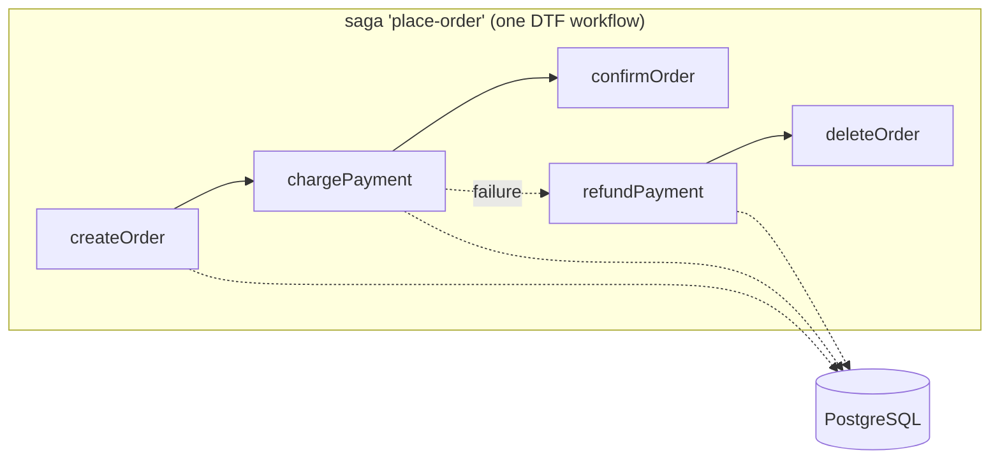

# Distributed Saga Framework (DSF)

An orchestration-based saga implementation built on top of the
[Distributed Task Framework (DTF)](../core/README.md). A saga is a chain of business methods where every method may
have a compensating method; when a step fails, the already executed steps are compensated in reverse order. DSF
persists saga state in the same PostgreSQL database DTF uses, so no extra infrastructure is needed.

This document covers `distributed-task-base-saga-library`, `distributed-task-base-saga-spring-boot-autoconfigure`
and `distributed-task-base-saga-spring-boot-starter`. Test helpers are described in
[../test-utils/dsf/README.md](../test-utils/dsf/README.md).

<!-- TOC -->
* [Distributed Saga Framework (DSF)](#distributed-saga-framework-dsf)
  * [Introduction](#introduction)
    * [Why a saga](#why-a-saga)
    * [How DSF maps a saga onto DTF](#how-dsf-maps-a-saga-onto-dtf)
    * [Features](#features)
  * [Install](#install)
    * [Dependencies](#dependencies)
    * [Database migrations](#database-migrations)
    * [Configuration](#configuration)
  * [Quick start](#quick-start)
    * [An order saga](#an-order-saga)
    * [What happened](#what-happened)
  * [Concepts](#concepts)
    * [Saga methods](#saga-methods)
    * [Revert methods](#revert-methods)
    * [Building a flow](#building-a-flow)
    * [What each step receives](#what-each-step-receives)
    * [Working with a running saga](#working-with-a-running-saga)
    * [Failure and compensation](#failure-and-compensation)
    * [Cancellation](#cancellation)
    * [Lifetime and timeouts](#lifetime-and-timeouts)
    * [Affinity](#affinity)
    * [Versioning and rolling deployments](#versioning-and-rolling-deployments)
    * [Execution guarantees, retries and limits per method](#execution-guarantees-retries-and-limits-per-method)
  * [Configuration reference](#configuration-reference)
    * [Saga settings](#saga-settings)
    * [Saga method settings](#saga-method-settings)
    * [Common and statistics settings](#common-and-statistics-settings)
    * [Full example](#full-example)
  * [How it works](#how-it-works)
  * [Metrics](#metrics)
  * [Testing](#testing)
  * [Troubleshooting](#troubleshooting)
  * [Example application](#example-application)
  * [License](#license)
  * [Disclaimer](#disclaimer)
<!-- TOC -->

## Introduction

### Why a saga

A business operation often spans several systems: write a row locally, call service A, call service B, write an
audit record. A local transaction protects only the first write. If the call to B fails, A has already been
changed and the HTTP response to the caller is long gone. The saga pattern solves this with **compensation**: each
step that changes state is paired with a method that undoes it, and the orchestrator runs those methods backwards
when a later step fails.

DSF gives you that orchestrator as a fluent Java API, with persistence, retries, timeouts, cancellation and
cluster-wide execution inherited from DTF.

### How DSF maps a saga onto DTF



- Every method annotated with `@SagaMethod` or `@SagaRevertMethod` becomes a **DTF task** named
  `_____SAGA_<name>` / `_____SAGA_REVERT_<name>`.
- A started saga is a **DTF workflow**: step one is scheduled as a task; when it finishes it schedules step two,
  and so on. All steps share the workflow id and affinity, so DTF cancellation and waiting work on the whole saga.
- The chain itself (which methods, in which order, serialized inputs and outputs) travels as the message of those
  tasks. A row in `_____dtf_saga` tracks the saga: name, root task, completion, result, cancellation flag,
  expiration.
- Retries, timeouts, execution guarantees and parallelism limits of a step are plain DTF task settings.

### Features

- Fluent builder: `create(...)`, `registerToRun(...)`, `thenRun(...)`, `thenConsume(...)`, `start()`.
- Compensation chain executed backwards from the failed step, with the original exception available to the
  compensating method.
- Each step is retried according to its own policy; `noRetryFor` short-circuits retries for unrecoverable errors.
- Synchronous (`get()` / `waitCompletion()`) and asynchronous (`trackId()` + `getFlow()`) usage.
- Graceful cancellation (finish the current step, then compensate) and forced shutdown.
- Saga expiration with a dead letter table for sagas that never finished.
- Affinity: sagas touching the same resource run one after another.
- Versioned saga methods for rolling deployments; a step that only a newer node knows is routed there.
- `@Transactional` saga methods automatically run with DTF exactly-once guarantee.
- Micrometer metrics per saga name and state.
- Disabled mode: a no-op `DistributionSagaService` proxy when the saga module is switched off.

## Install

### Dependencies

Gradle:

```groovy
implementation 'io.github.cherkovskiyandrey:distributed-task-base-saga-spring-boot-starter:2.0.0-rc.2'
runtimeOnly 'org.postgresql:postgresql'
```

Maven:

```xml
<dependency>
    <groupId>io.github.cherkovskiyandrey</groupId>
    <artifactId>distributed-task-base-saga-spring-boot-starter</artifactId>
    <version>2.0.0-rc.2</version>
</dependency>
```

The saga starter transitively brings the DTF starter (`distributed-task-spring-boot-starter`) and
`liquibase-core`; you do not need to declare the DTF starter separately. Requirements are the same as for DTF:
Java 17+, Spring Boot 3.3.x, PostgreSQL.

### Database migrations

Include both the DTF and the saga changelogs in your Liquibase master:

```yaml
databaseChangeLog:
  - include:
      file: db/changelog/distributed-task-framework/db.changelog-aggregator.yaml
  - include:
      file: db/changelog/distributed-task-base-saga/db.changelog-aggregator.yaml
```

The saga changelog creates two tables, `_____dtf_saga` and `_____dtf_saga_dls`. Raw SQL for other migration tools:
`db/changelog/distributed-task-base-saga/sql/001_dtf_saga_init.up.sql` (and `.down.sql`) inside
`distributed-task-base-saga-library`.

### Configuration

Both the DTF core and the saga module must be switched on explicitly:

```yaml
distributed-task:
  enabled: true
  common:
    app-name: 'orders-app'
  saga:
    enabled: true
```

If either flag is missing, a no-op proxy is registered as `DistributionSagaService`: every call logs a warning,
`start()` schedules nothing and `get()` returns `Optional.empty()`.

## Quick start

### An order saga

Messages are plain Jackson-serializable classes; records work well.

```java
public record OrderRequest(UUID orderId, UUID customerId, BigDecimal amount) {}
public record OrderCreated(UUID orderId) {}
public record PaymentReceipt(String transactionId) {}
public record OrderConfirmation(UUID orderId, String transactionId) {}
```

Saga methods and their compensations live in an ordinary Spring bean. Note how the parameters of each method
follow from its position in the chain (explained in [What each step receives](#what-each-step-receives)).

```java
import com.distributed_task_framework.saga.autoconfigure.annotations.SagaMethod;
import com.distributed_task_framework.saga.autoconfigure.annotations.SagaRevertMethod;
import com.distributed_task_framework.saga.exceptions.SagaExecutionException;
import com.distributed_task_framework.saga.services.DistributionSagaService;
import com.distributed_task_framework.saga.services.SagaFlow;
import jakarta.annotation.Nullable;
import org.springframework.dao.DuplicateKeyException;
import org.springframework.stereotype.Service;
import org.springframework.transaction.annotation.Transactional;

@Service
public class OrderSagaService {
    private final OrderRepository orderRepository;
    private final PaymentGateway paymentGateway;
    private final DistributionSagaService sagaService;

    public OrderSagaService(OrderRepository orderRepository,
                            PaymentGateway paymentGateway,
                            DistributionSagaService sagaService) {
        this.orderRepository = orderRepository;
        this.paymentGateway = paymentGateway;
        this.sagaService = sagaService;
    }

    public SagaFlow<OrderConfirmation> placeOrder(OrderRequest request) {
        return sagaService
            .createWithAffinity("place-order", "ORDERS", request.orderId().toString())
            .registerToRun(this::createOrder, this::deleteOrder, request)   // step 1 + compensation
            .thenRun(this::chargePayment, this::refundPayment)             // step 2 + compensation
            .thenRun(this::confirmOrder)                                   // step 3, nothing to compensate
            .start();
    }

    // ---- step 1: receives the root input ---------------------------------------------------------

    @Transactional
    @SagaMethod(name = "createOrder", noRetryFor = DuplicateKeyException.class)
    public OrderCreated createOrder(OrderRequest request) {
        orderRepository.insert(request.orderId(), request.customerId(), request.amount());
        return new OrderCreated(request.orderId());
    }

    @Transactional
    @SagaRevertMethod(name = "deleteOrder")
    public void deleteOrder(OrderRequest request,
                            @Nullable OrderCreated created,
                            @Nullable SagaExecutionException error) {
        if (created != null) {
            orderRepository.deleteById(created.orderId());
        }
    }

    // ---- step 2: receives the previous output and the root input ---------------------------------

    @SagaMethod(name = "chargePayment", noRetryFor = InsufficientFundsException.class)
    public PaymentReceipt chargePayment(OrderCreated created, OrderRequest request) {
        return paymentGateway.charge(request.customerId(), request.amount(), created.orderId());
    }

    @SagaRevertMethod(name = "refundPayment")
    public void refundPayment(@Nullable OrderCreated created,
                              OrderRequest request,
                              @Nullable PaymentReceipt receipt,
                              @Nullable SagaExecutionException error) {
        if (receipt != null) {
            paymentGateway.refund(receipt.transactionId());
        }
    }

    // ---- step 3: last step, its return value is the saga result -----------------------------------

    @SagaMethod(name = "confirmOrder")
    public OrderConfirmation confirmOrder(PaymentReceipt receipt, OrderRequest request) {
        return new OrderConfirmation(request.orderId(), receipt.transactionId());
    }
}
```

Expose it the way your application needs: synchronously, asynchronously with polling, or with cancellation.

```java
@RestController
@RequestMapping("/orders")
public class OrderController {
    private final OrderSagaService orderSagaService;
    private final DistributionSagaService sagaService;

    public OrderController(OrderSagaService orderSagaService, DistributionSagaService sagaService) {
        this.orderSagaService = orderSagaService;
        this.sagaService = sagaService;
    }

    /** Wait for the whole saga (including compensation on failure) and return the result. */
    @PostMapping
    public OrderConfirmation placeOrder(@RequestBody OrderRequest request)
        throws InterruptedException, TimeoutException {
        return orderSagaService.placeOrder(request)
            .get(Duration.ofMinutes(1))
            .orElseThrow();
    }

    /** Return immediately with an id the client can poll. */
    @PostMapping("/async")
    public UUID placeOrderAsync(@RequestBody OrderRequest request) {
        return orderSagaService.placeOrder(request).trackId();
    }

    /** 200 with the result when done, 202 while running, 404 when unknown or already cleaned up. */
    @GetMapping("/{trackId}")
    public ResponseEntity<OrderConfirmation> poll(@PathVariable UUID trackId)
        throws InterruptedException, TimeoutException {
        try {
            SagaFlow<OrderConfirmation> flow = sagaService.getFlow(trackId, OrderConfirmation.class);
            if (!flow.isCompleted()) {
                return ResponseEntity.accepted().build();
            }
            return ResponseEntity.of(flow.get());
        } catch (SagaNotFoundException e) {
            return ResponseEntity.notFound().build();
        }
    }

    /** Graceful cancel: finish the running step, then compensate everything that has run. */
    @DeleteMapping("/{trackId}")
    public void cancel(@PathVariable UUID trackId) {
        sagaService.getFlow(trackId).cancel(true);
    }
}
```

### What happened

1. On startup DSF scanned all non-lazy singleton beans for `@SagaMethod` / `@SagaRevertMethod` and registered one
   DTF task per method: `_____SAGA_createOrder`, `_____SAGA_REVERT_deleteOrder`, `_____SAGA_chargePayment`, …
   `createOrder` and `deleteOrder` are `@Transactional`, so their tasks run with DTF exactly-once guarantee.
2. `createWithAffinity("place-order", "ORDERS", orderId)` created an in-memory builder. Each `registerToRun` /
   `thenRun` resolved the method reference to a registered task and appended a step to the pipeline. Nothing was
   persisted yet.
3. `start()` scheduled the first task and inserted the saga row in **one transaction**. If you call `start()`
   inside your own `@Transactional` method on the same data source, the saga begins only when that transaction
   commits.
4. A DTF worker ran `createOrder`, stored its serialized output in the pipeline and scheduled `chargePayment`,
   which received that output plus the root input. The last step's return value was stored as the saga result and
   the saga was marked completed.
5. Had `chargePayment` thrown `InsufficientFundsException`, DSF would have skipped retries (`noRetryFor`), stored
   the exception as the saga result, run `refundPayment` (with `receipt == null` and the exception) and then
   `deleteOrder` (with `error == null`), and only then marked the saga completed. `get()` would throw a
   `SagaExecutionException` wrapping the original error.
6. Because of the affinity, a second `place-order` saga for the same `orderId` waits until the first one, including
   its compensation, is complete.

## Concepts

### Saga methods

A saga method is any method of a Spring bean annotated with `@SagaMethod`:

```java
@SagaMethod(
    name = "chargePayment",                             // required, unique in the cluster
    version = 2,                                        // optional, default 0
    noRetryFor = {InsufficientFundsException.class}     // optional, exceptions that skip retries
)
public PaymentReceipt chargePayment(OrderCreated created, OrderRequest request) { ... }
```

| Attribute | Meaning |
|---|---|
| `name` | logical name, independent of the Java method name. Maps to the DTF task `_____SAGA_<name>` and is the key for per-method configuration. Must be unique in the cluster. |
| `version` | appended to the task name as `_v<N>` (`0` adds nothing). Lets two versions of a method coexist during a rolling deployment, see [Versioning](#versioning-and-rolling-deployments). |
| `noRetryFor` | exception classes (matched against the thrown exception and its cause chain) that end the step immediately and start compensation. |

Rules and capabilities:

- The bean must be a **non-lazy singleton**. Beans are collected while the context starts and registered in the
  DTF `start` phase; lazy beans and prototypes are ignored by design, and `spring.main.lazy-initialization=true`
  disables saga registration entirely (a warning is logged).
- The method may be `public`, package-private or `private`, and may be declared on an interface or a superclass.
  DSF unwraps Spring proxies and makes the method accessible.
- Only **bound method references** can be passed to the builder: `this::method` or `someBean::method`. A lambda or
  an unbound reference fails with `SagaMethodResolvingException`; a reference to a method without the annotation
  fails with `SagaMethodNotFoundException`.
- A method has one or two parameters, see [What each step receives](#what-each-step-receives). The return type may
  be `void`.
- `@Transactional` on a saga method switches its DTF task to `EXACTLY_ONCE`: the method body and the bookkeeping
  of the step run in a single database transaction managed by DTF. The Spring transactional proxy itself is not
  involved because the method is invoked on the target object.
- Several beans of the same class that both declare saga methods must implement `SagaSpecific` and return
  different `suffix()` values; the suffix becomes part of the task name (`_____SAGA_<name>_<suffix>[_vN]`).

### Revert methods

A revert (compensating) method is annotated with `@SagaRevertMethod(name, version)` and returns `void`. It is
paired with a saga method at build time, not by annotation, so one revert method can serve several steps.

Its parameters are the ones of the paired saga method, followed by the saga method's output (for steps that
return a value) and a `SagaExecutionException`:

| Step registered as | Saga method parameters | Revert method parameters |
|---|---|---|
| `registerToRun(op, revert, input)` | `(INPUT)` | `(INPUT, OUTPUT, SagaExecutionException)` |
| `registerToConsume(op, revert, input)` | `(INPUT)` | `(INPUT, SagaExecutionException)` |
| `thenRun(SagaBiFunction, revert)` | `(PARENT_OUTPUT, ROOT_INPUT)` | `(PARENT_OUTPUT, ROOT_INPUT, OUTPUT, SagaExecutionException)` |
| `thenRun(SagaFunction, revert)` | `(PARENT_OUTPUT)` | `(PARENT_OUTPUT, OUTPUT, SagaExecutionException)` |
| `thenConsume(SagaBiConsumer, revert)` | `(PARENT_OUTPUT, ROOT_INPUT)` | `(PARENT_OUTPUT, ROOT_INPUT, SagaExecutionException)` |
| `thenConsume(SagaConsumer, revert)` | `(PARENT_OUTPUT)` | `(PARENT_OUTPUT, SagaExecutionException)` |
| after a consume step: `thenRun(SagaFunction, revert)` | `(ROOT_INPUT)` | `(ROOT_INPUT, OUTPUT, SagaExecutionException)` |
| after a consume step: `thenConsume(SagaConsumer, revert)` | `(ROOT_INPUT)` | `(ROOT_INPUT, SagaExecutionException)` |

Mark `OUTPUT`, `PARENT_OUTPUT` and the exception as `@Nullable`:

- `OUTPUT` is `null` when the step itself failed (it never produced a value) or when it was cancelled before it
  ran.
- The exception is non-null **only in the revert of the step that failed**. Reverts of earlier, successful steps
  receive `null`.
- `PARENT_OUTPUT` is `null` when the previous step returned nothing.

Compensation should be idempotent: a revert task is retried like any DTF task, and in at-least-once mode it may
run twice.

```java
@SagaRevertMethod(name = "deleteOrder")
public void deleteOrder(OrderRequest request,
                        @Nullable OrderCreated created,
                        @Nullable SagaExecutionException error) {
    if (error != null && error.isCauseRelatedTo(DuplicateKeyException.class)) {
        return; // the order existed before this saga, nothing to undo
    }
    if (created != null) {
        orderRepository.deleteById(created.orderId());
    }
}
```

`SagaExecutionException` carries the original error. `getCause()` is the deserialized exception when its class is
on the classpath of the executing node, otherwise `null`; `getRootCauseType()` always holds the class name, and
`isCauseRelatedTo(Class)` / `isTheSameBaseOnSimpleName(Class)` compare safely in both cases.

### Building a flow

`DistributionSagaService` is the entry point:

```java
SagaFlowEntryPoint create(String name);
SagaFlowEntryPoint create(String name, SagaSettings settings);
SagaFlowEntryPoint createWithAffinity(String name, String affinityGroup, String affinity);
SagaFlowEntryPoint createWithAffinity(String name, String affinityGroup, String affinity, SagaSettings settings);

<T> SagaFlow<T> getFlow(UUID trackId, Class<T> resultClass);   // throws SagaNotFoundException
SagaFlowWithoutResult getFlow(UUID trackId);                   // throws SagaNotFoundException
```

`name` is the saga name used for configuration, metrics and statistics. Without explicit `SagaSettings` the
settings configured for that name (or the defaults) are used.

The first step takes the **root input** value; it is the only place where a value is passed in:

```java
<INPUT, OUTPUT> SagaFlowBuilder<INPUT, OUTPUT> registerToRun(SagaFunction<INPUT, OUTPUT> op,
                                                             SagaRevertibleBiConsumer<INPUT, OUTPUT> revert,
                                                             INPUT input);
<INPUT, OUTPUT> SagaFlowBuilder<INPUT, OUTPUT> registerToRun(SagaFunction<INPUT, OUTPUT> op, INPUT input);
<INPUT> SagaFlowBuilderWithoutInput<INPUT> registerToConsume(SagaConsumer<INPUT> op,
                                                             SagaRevertibleConsumer<INPUT> revert,
                                                             INPUT input);
<INPUT> SagaFlowBuilderWithoutInput<INPUT> registerToConsume(SagaConsumer<INPUT> op, INPUT input);
```

Then chain steps. Every `thenRun` / `thenConsume` exists with and without a revert argument; the variant without
a revert is the "nothing to compensate" step.

```java
// after a step that returned a value: SagaFlowBuilder<ROOT_INPUT, PARENT_OUTPUT>
.thenRun(SagaBiFunction<PARENT_OUTPUT, ROOT_INPUT, OUTPUT> op[, SagaRevertibleThreeConsumer<...> revert])
.thenRun(SagaFunction<PARENT_OUTPUT, OUTPUT> op[, SagaRevertibleBiConsumer<PARENT_OUTPUT, OUTPUT> revert])
.thenConsume(SagaBiConsumer<PARENT_OUTPUT, ROOT_INPUT> op[, SagaRevertibleBiConsumer<...> revert])
.thenConsume(SagaConsumer<PARENT_OUTPUT> op[, SagaRevertibleConsumer<PARENT_OUTPUT> revert])
.start()                                   // -> SagaFlow<PARENT_OUTPUT>

// after a void step: SagaFlowBuilderWithoutInput<ROOT_INPUT>
.thenRun(SagaFunction<ROOT_INPUT, OUTPUT> op[, SagaRevertibleBiConsumer<ROOT_INPUT, OUTPUT> revert])
.thenConsume(SagaConsumer<ROOT_INPUT> op[, SagaRevertibleConsumer<ROOT_INPUT> revert])
.start()                                   // -> SagaFlowWithoutResult
```

The compiler checks that every method's parameters match what the previous step produces. The result type of the
saga is the return type of the **last** step; a `void` last step yields a `SagaFlowWithoutResult`.

Builders are immutable: every call returns a new builder, so conditional construction must reassign:

```java
SagaFlowBuilder<OrderRequest, OrderCreated> flow = sagaService.create("place-order")
    .registerToRun(this::createOrder, this::deleteOrder, request);

if (request.amount().signum() > 0) {
    // the generic parameters change with each step, so declare a new variable
    SagaFlowBuilder<OrderRequest, PaymentReceipt> paid = flow.thenRun(this::chargePayment, this::refundPayment);
    return paid.thenRun(this::confirmOrder).start();
}
return flow.thenRun(this::confirmFreeOrder).start();
```

### What each step receives

Inputs are not passed along by you; DSF binds them from the pipeline:

- **Root input**: the value given to `registerToRun` / `registerToConsume`, serialized once and available to
  every step and every revert method of the saga.
- **Parent output**: the return value of the immediately preceding step.
- **Own output**: available to a step's revert method after the step succeeded.

So a method in the middle of the chain is written either as `f(parentOutput)` or as `f(parentOutput, rootInput)`;
after a `void` step there is no parent output and the next method is `f(rootInput)`. Generic types such as
`Result<Order>` are supported: DSF deserializes arguments using the declared parameter types.

Everything that crosses a step boundary is serialized with the DTF `TaskSerializer` (Jackson). Keep inputs and
outputs small and serializable, and prefer additive changes to them during rolling deployments.

### Working with a running saga

`start()` returns a `SagaFlow<T>` (or `SagaFlowWithoutResult`). The same object can be re-obtained later from the
track id with `getFlow(...)`.

```java
UUID trackId = flow.trackId();              // id for polling, logging and cancellation
boolean done = flow.isCompleted();          // true after the forward chain OR the revert chain finished
boolean canceled = flow.isCanceled();       // graceful cancellation requested
flow.waitCompletion();                      // block until done; default DTF timeout (1 minute)
flow.waitCompletion(Duration.ofMinutes(5));
Optional<T> result = flow.get();            // wait, then return the result of the last step
Optional<T> result = flow.get(Duration.ofMinutes(5));
flow.cancel(true);                          // graceful
flow.cancel(false);                         // force
```

`get()` and `waitCompletion()` block until the saga is **completed**, which includes the compensation chain when
the saga failed or was cancelled gracefully. They then report the outcome:

| Outcome | `get()` / `waitCompletion()` |
|---|---|
| last step returned a value | `Optional.of(value)` / returns |
| last step returned `void` or `null` | `Optional.empty()` / returns |
| a step failed and compensation finished | throws `SagaExecutionException` (the original error as cause) |
| cancelled gracefully | throws `SagaCancellationException` |
| saga unknown, expired, force-cancelled, or already cleaned up | throws `SagaNotFoundException` |
| waiting timed out | throws `TimeoutException` (the saga keeps running) |

The result stays readable for `availableAfterCompletionTimeout` (1 minute by default) after completion; after
that the row is removed and `getFlow` throws `SagaNotFoundException`. Poll with `isCompleted()` (results are
cached for `distributed-task.saga.common.cache-expiration`, 1 s by default) and call `get()` once it is `true`.

Do not call `get()` or `waitCompletion()` from inside a saga method or any other DTF task: DTF forbids waiting on
tasks from a task and throws `InvalidOperationException`.

### Failure and compensation

When a saga method throws:

1. DTF retries the step according to the method's retry policy (`FIXED`, 10 s, up to 6 attempts by default).
   Exceptions listed in `noRetryFor` (or found in the cause chain) skip retries.
2. After the last attempt the exception is serialized (without stack trace) and stored as the saga result, and the
   **revert chain** starts from the failed step: its own revert runs first (if it has one, with `output == null`
   and the exception), then the reverts of the previous steps in reverse order, each receiving `null` as the
   exception.
3. When the revert chain finishes the saga is marked completed. Only then do `get()` / `waitCompletion()` return,
   throwing `SagaExecutionException`.

Steps registered without a revert are skipped during compensation. Compensation is never run for a step that has
not started.

**When a revert method throws**, its task is retried with the revert method's retry policy. If it still fails,
DSF logs the error and by default **continues with the next revert**; the saga result remains the original forward
exception. Set `stopOnFailedAnyRevert` to end the chain instead:

```java
SagaSettings settings = SagaSettings.builder().stopOnFailedAnyRevert(true).build();
sagaService.create("place-order", settings)...
```

> Note on the current implementation: with `stopOnFailedAnyRevert = true` the saga is marked completed after the
> **first revert task finishes, whether it failed or succeeded**. The flag therefore behaves as "run at most one
> compensation step" rather than "stop on the first failed compensation". Keep that in mind until the behaviour
> is aligned with the Javadoc.

Failed compensations are not written to the dead letter saga table today; rely on logs and the
`worker.final.completed.error` DTF metric with `task_name=_____SAGA_REVERT_*` to detect them.

### Cancellation

`cancel(true)` (graceful) sets a flag on the saga. The step that is running is **not** interrupted. As soon as the
next saga task starts, or the running one finishes, DSF stops going forward and runs the revert chain:

- if the step has not started yet, compensation begins with the previous step;
- if the step was running, its own revert runs first with `output == null`;
- if the cancelled step was in a retry loop, its last exception is passed to its revert.

Afterwards `get()` / `waitCompletion()` throw `SagaCancellationException`. Cancelling a saga that is already
compensating has no effect.

`cancel(false)` (force) cancels the DTF workflow (running steps get `Thread.interrupt()`), deletes the saga row and
runs **no** compensation. Any later `getFlow` / `get` throws `SagaNotFoundException`. Use it for operator
intervention, not as a normal flow.

### Lifetime and timeouts

| Setting | Default | Effect |
|---|---|---|
| `SagaSettings.expirationTimeout` | `PT1H` | a saga that is not completed by then is force-shut-down by the saga manager task: its workflow is cancelled, no compensation runs, the saga row is moved to `_____dtf_saga_dls` (dead letter sagas). Clients get `SagaNotFoundException`. |
| `SagaSettings.availableAfterCompletionTimeout` | `PT1M` | how long the result of a completed saga stays readable; afterwards the row is deleted. |
| `SagaMethodSettings.timeout` | `PT0S` (off) | per-step timeout: the executing thread is interrupted and the attempt counts as failed (retry, then compensation). |
| `get(Duration)` / `waitCompletion(Duration)` | DTF default (1 min) | client-side waiting only; does not affect the saga. |

Choose `expirationTimeout` generously: it must cover all steps, all their retries and the whole revert chain.
A saga that hits it is not compensated. The sweep that removes completed sagas and shuts down expired ones runs
every `distributed-task.saga.common.deprecated-saga-scan-fixed-delay` (10 s) on one node of the cluster.

Settings are applied per saga instance:

```java
SagaSettings settings = SagaSettings.builder()
    .expirationTimeout(Duration.ofMinutes(30))
    .availableAfterCompletionTimeout(Duration.ofMinutes(5))
    .build();

sagaService.create("place-order", settings)...                 // this instance only
sagaService.registerSagaSettings("place-order", settings);      // every create("place-order") from now on
sagaService.registerDefaultSagaSettings(settings);              // every saga without its own settings
```

or in properties, see [Configuration reference](#configuration-reference).

### Affinity

`createWithAffinity(name, affinityGroup, affinity)` schedules every task of the saga with that DTF affinity.
The effect is the one described in the [DTF documentation](../core/README.md#affinity): sagas with the same
`affinityGroup` + `affinity` are executed **one after another**, in creation order, including their compensation
chains. Sagas with different affinities, and sagas created with plain `create(name)`, run in parallel.

This is the tool for "never process two operations on the same order concurrently". It does not pin a saga to a
node; the steps of one saga may run on different nodes anyway.

### Versioning and rolling deployments

A saga pipeline is persisted with the **task names** of its steps. During a rolling deployment two builds of your
application run side by side and the following must hold:

- a step scheduled by an old node must be executable by whichever node picks it up;
- an in-flight saga must be able to finish with the methods it started with.

DSF supports this in two ways:

1. **Cross-node routing.** When the node that finished step N does not have the task for step N+1 registered
   (because only the other build has it), it still schedules the task as long as some node in the cluster
   advertises it; that node executes it. If no node knows the task, the step fails with
   `SagaTaskNotFoundException` and the saga is compensated.
2. **Versioned methods.** When you change a method's parameters or semantics, keep the old method and add a new
   one with a higher `version`. Both are separate tasks (`_____SAGA_<name>` and `_____SAGA_<name>_v2`), so
   in-flight sagas keep using the old one while new sagas, built with the new method reference, use the new one.
   Remove the old method once no saga can reference it any more.

```java
@Deprecated(forRemoval = true)
@SagaMethod(name = "chargePayment")
public PaymentReceipt chargePaymentOld(OrderCreated created, OrderRequest request) { ... }

@SagaMethod(name = "chargePayment", version = 2)
public PaymentReceipt chargePayment(OrderCreated created, OrderRequest request) { ... }
```

There is no automatic version negotiation: the method reference passed to the builder decides which task is used.

Because inputs and outputs are JSON, additive changes to them (new optional fields) are safe with the default
tolerant `ObjectMapper`. Renaming or removing fields requires a new method version.

### Execution guarantees, retries and limits per method

Each saga method and each revert method runs as a DTF task with its own `SagaMethodSettings`:

| Setting | Default | Notes |
|---|---|---|
| `execution-guarantees` | `AT_LEAST_ONCE`; `EXACTLY_ONCE` when the method is `@Transactional` | see [DTF execution guarantees](../core/README.md#execution-guarantees) |
| `retry` | `FIXED`, delay 10 s, 6 attempts | same structure as DTF `retry` |
| `no-retry-for` | empty | list of exception classes |
| `max-parallel-in-cluster` | unlimited | how many instances of this method run concurrently cluster-wide |
| `timeout` | off | per-attempt timeout |

Dead letter table and cron are always off for saga tasks: a failed saga is reported through its result, not
through the DLT.

## Configuration reference

All saga properties live under `distributed-task.saga`. Precedence for a saga method is: code defaults, then
`default-saga-method-properties`, then annotations (`noRetryFor`, `@Transactional`), then
`saga-method-properties.<key>`. The key of a method is `<name>[_<suffix>][_v<version>]`, exactly as in the task
name without the `_____SAGA_` prefix (for example `chargePayment_v2`; version 0 has no suffix).

### Saga settings

```yaml
distributed-task:
  saga:
    saga-properties-group:
      default-saga-properties:
        available-after-completion-timeout: PT1M
        expiration-timeout: PT1H
        stop-on-failed-any-revert: false
      saga-properties-group:          # keyed by saga name
        place-order:
          expiration-timeout: PT30M
```

Per-name settings apply to `create(name)` / `createWithAffinity(name, ...)` calls **without** an explicit
`SagaSettings` argument.

### Saga method settings

```yaml
distributed-task:
  saga:
    saga-method-properties-group:
      default-saga-method-properties:
        execution-guarantees: AT_LEAST_ONCE
        retry:
          retry-mode: FIXED
          fixed:
            delay: PT5S
            max-number: 5
            max-interval: PT5M
        max-parallel-in-cluster: -1
        timeout: PT10M
      saga-method-properties:          # keyed by saga method name (+ suffix, + version)
        chargePayment_v2:
          retry:
            retry-mode: BACKOFF
            backoff:
              initial-delay: PT2S
              delay-period: PT2S
              max-retries: 8
              max-delay: PT1M
          no-retry-for:
            - com.example.payments.InsufficientFundsException
          max-parallel-in-cluster: 20
          timeout: PT30S
        refundPayment:
          retry:
            retry-mode: FIXED
            fixed:
              delay: PT30S
              max-number: 10
```

### Common and statistics settings

```yaml
distributed-task:
  saga:
    common:
      cache-expiration: PT1S                        # cache for isCompleted()/getFlow existence checks
      deprecated-saga-scan-fixed-delay: PT10S       # sweep period: remove completed, shut down expired sagas
      expired-saga-batch-size-to-remove: 1000       # expired sagas handled per sweep
    saga-stat-properties:
      calc-initial-delay: PT10S
      calc-fixed-delay: PT10S
      top-n-sagas: 15                               # saga names per state exposed as gauges
```

### Full example

```yaml
distributed-task:
  enabled: true
  common:
    app-name: orders-app
  saga:
    enabled: true
    common:
      cache-expiration: PT1S
      deprecated-saga-scan-fixed-delay: PT10S
      expired-saga-batch-size-to-remove: 1000
    saga-stat-properties:
      top-n-sagas: 15
      calc-initial-delay: PT10S
      calc-fixed-delay: PT10S
    saga-properties-group:
      default-saga-properties:
        available-after-completion-timeout: PT1M
        expiration-timeout: PT1H
        stop-on-failed-any-revert: false
      saga-properties-group:
        place-order:
          expiration-timeout: PT30M
          available-after-completion-timeout: PT5M
    saga-method-properties-group:
      default-saga-method-properties:
        retry:
          retry-mode: FIXED
          fixed:
            delay: PT5S
            max-number: 5
        timeout: PT10M
      saga-method-properties:
        chargePayment_v2:
          max-parallel-in-cluster: 20
          no-retry-for:
            - com.example.payments.InsufficientFundsException
```

The DTF core properties (`distributed-task.common.*`, `distributed-task.task-properties-group.*`) apply to the
saga tasks as to any other task; saga method settings override the task defaults for saga tasks.

## How it works

- **Discovery.** A dependency-free `BeanPostProcessor` records the names of eligible beans while the context is
  built. In the DTF `start` phase (after the context is refreshed) `SagaConfigurationDiscoveryProcessor` inspects
  those beans, resolves annotations through interfaces, superclasses and proxies, builds `SagaMethodSettings`
  from defaults, properties and annotations, and registers every method as a DTF task via `registerTask`.
- **Pipeline.** The builder produces a `SagaPipeline`: an ordered list of actions, each with the task names of its
  saga method and revert method, the argument schema and, at runtime, the serialized output or exception. The
  pipeline is the message of every saga task and moves with the saga from step to step.
- **Steps.** A saga method task deserializes its arguments from the pipeline, invokes the method by reflection,
  stores the output, and schedules the next task (locally, or on another node if only that node knows it). The
  last step stores the saga result and marks the saga completed. Failures run through the revert tasks in the same
  way, backwards.
- **Saga row.** `_____dtf_saga` holds one row per saga: `saga_id` (the track id), `name`, root task id,
  `created / completed / expiration` timestamps, `canceled`, `result` and `exception_type`, and the last pipeline
  snapshot. `_____dtf_saga_dls` receives sagas that expired before completing.
- **Manager task.** DSF registers one internal DTF task, `INTERNAL_SAGA_MANAGER_TASK`, scheduled every
  `deprecated-saga-scan-fixed-delay` with cluster-wide parallelism 1. It deletes completed sagas whose availability
  window has passed and force-shuts-down expired ones.
- **Statistics.** On the node that runs the DTF queue-manager planner, `SagaStatService` aggregates the saga table
  every `calc-fixed-delay` and publishes gauges per state and per saga name.

## Metrics

All metrics go through the application's `MeterRegistry`.

| Metric | Type | Tags | Meaning |
|---|---|---|---|
| `saga.action.create` | counter | `saga_name` | sagas started |
| `saga.action.completed` | counter | `saga_name` | sagas completed (forward or after compensation) |
| `saga.action.complete-ok-with-result` | counter | `saga_name` | completed with a non-void result |
| `saga.action.complete-failed-with-result` | counter | `saga_name` | a step failed on its last attempt |
| `saga.action.cancel` | counter | `saga_name` | graceful cancellations requested |
| `saga.action.manual-shutdown` | counter | `saga_name` | forced cancellations |
| `saga.action.expired-shutdown` | counter | `saga_name` | sagas shut down by expiration and moved to DLS |
| `saga.action.removed` | counter | `saga_name` | completed sagas removed after the availability window |
| `saga.timer.completed` | timer | `saga_name` | time from creation to completion |
| `saga.state.all`, `saga.state.active`, `saga.state.completed`, `saga.state.completed_cleaning`, `saga.state.completed_not_cleaned`, `saga.state.expired`, `saga.state.expired_not_cleaned` | gauge | | sagas per state |
| `saga.state.topn.<state>` | gauge | `saga_name` | top-N saga names per state |
| `aggregatedSagaStatCalculationTimer`, `aggregatedSagaTopNStatCalculationTimer` | timer | | duration of the statistics queries |

`*_not_cleaned` states growing means the saga manager task is not running; check that the DTF planner is active
and that `INTERNAL_SAGA_MANAGER_TASK` is not failing. In addition, every saga and revert method produces the
standard DTF task metrics with `task_name=_____SAGA_<name>` / `_____SAGA_REVERT_<name>`.

## Testing

Use `distributed-task-base-saga-test-spring-boot-starter`, which brings the DTF test starter, fast planner and
worker settings, a mocked cluster provider and the `SagaTestUtil` bean that resets sagas and tasks between tests.
See [../test-utils/dsf/README.md](../test-utils/dsf/README.md).

## Troubleshooting

**`SagaMethodNotFoundException` / `SagaMethodResolvingException` when building a flow.** The method reference is
not a bound reference to an annotated method of a registered bean. Check that the bean is a non-lazy singleton,
that the annotation is present (possibly on an interface) and that you pass `bean::method`, not a lambda.

**`SagaMethodDuplicateException` on startup.** Two methods share a `name` + `version` (+ suffix), or two beans of
the same class declare saga methods without `SagaSpecific`.

**`SagaNotStartedException` from `start()`.** Scheduling the first task or inserting the saga row failed. The
first step's task must be registered on the node that calls `start()`.

**`SagaNotFoundException` right after completion.** The result was read later than `availableAfterCompletionTimeout`
after completion, or the saga expired, or it was force-cancelled. Increase the timeout or poll sooner.

**`get()` returns `Optional.empty()` and nothing runs.** The module is disabled: both `distributed-task.enabled`
and `distributed-task.saga.enabled` must be `true`.

**Saga methods on a bean are ignored.** The bean is lazy, a prototype, or `spring.main.lazy-initialization=true`
is set.

**Compensation did not run.** Either the saga expired (`expirationTimeout`) and was moved to `_____dtf_saga_dls`,
or `cancel(false)` was used, or the failed step and all previous ones were registered without reverts.

## Example application

[examples/distributed-task-base-saga-test-application](../examples/distributed-task-base-saga-test-application)
is a runnable Spring Boot application (Java and Kotlin services) with a REST API under `/api/saga` that starts a
four-step saga synchronously or asynchronously, polls its result and cancels it gracefully or forcibly. The request
body lets you inject a failure or a delay at any step to watch retries, compensation and cancellation. Start
PostgreSQL with the repository `docker-compose.yaml`, run the application and open Swagger UI at
`/swagger-ui/index.html`.

## License

Copyright 2022 Cherkovskiy Andrey

Licensed under the Apache License, Version 2.0 (the "License");
you may not use this file except in compliance with the License.
You may obtain a copy of the License at

    http://www.apache.org/licenses/LICENSE-2.0

Unless required by applicable law or agreed to in writing, software
distributed under the License is distributed on an "AS IS" BASIS,
WITHOUT WARRANTIES OR CONDITIONS OF ANY KIND, either express or implied.
See the License for the specific language governing permissions and
limitations under the License.

## Disclaimer

All information and source code are provided AS-IS, without express or implied warranties.
Use of the source code or parts of it is at your sole discretion and risk.
Cherkovskiy Andrey takes reasonable measures to ensure the relevance of the information posted in this repository,
but does not assume responsibility for maintaining or updating this repository or its parts outside the framework
established independently and without notifying third parties.
